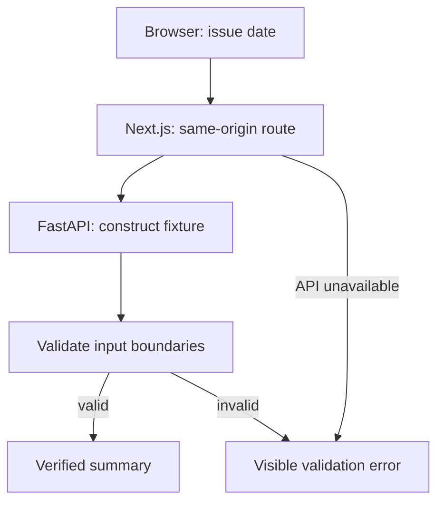

# Phase 1: make the project installable and its boundaries testable

## What changed

Phase 0 fixed what a forecast means. Phase 1 turns that agreement into a reusable Python package, an initial Next.js application, checked interfaces, and repeatable verification commands.

## 1. Why a package matters

The implementation lives in `src/gridlens`. Installing it exposes `gridlens fixture`. This command validates a synthetic input window and reports its boundaries. The fixture intentionally has no real provider data and no trained model. Its purpose is to prove that installation, imports, schemas, and the command interface work together.

Without an installed-package check, code can appear to work only because a notebook's current directory accidentally makes imports available. CI will install a clean environment and run the same entry point.

## 2. Validate data where components meet

`InputWindow` requires 336 historical demand values and the correct timestamps. `PointForecast` requires 48 finite outputs. `PredictionBand` rejects inverted bounds. `IntervalForecast` checks that the 80% band fits inside 90%, which fits inside 95%.

A JSON list with 47 values is valid JSON, but it is not a valid GridLens forecast. A timestamp can be syntactically correct and still refer to the wrong day. These checks make those mistakes visible at the boundary.

The schema files describe each record's fields. The Python validators additionally check relationships between fields, such as the gap and interval nesting.

## 3. Interfaces keep responsibilities separate

The dataset provides a manifest and examples. A point model learns from that dataset and predicts from an input window. A calibrator wraps a point forecast with intervals and receives actuals through a separate feedback method.

Later, persistence, ridge regression, LSTM, the original Transformer, and TimeXer will implement the same model interface. That makes comparison easier: each receives the same problem and produces the same output shape.

These are protocols, not pretend implementations. No Transformer is trained in Phase 1.

## 4. Check artifacts by content

A saved filename alone does not prove that a model or dataset is the expected version. GridLens records each file's size and SHA-256 hash. Changing even one byte causes verification to fail. A canonical manifest hash gives the bundle a repeatable identity.

Paths are relative to the bundle root. A member named `../outside` is rejected so verification cannot follow a manifest into unrelated files.

## 5. Follow one browser request

The user selects an issue date and clicks **Run contract check**. The browser requests `/api/fixture` from Next.js. Next.js calls FastAPI's `/v1/fixture`. Python constructs and validates the input window, then returns a summary. The browser displays the returned boundaries.



If Python is unavailable, the page displays a verification error. It does not replace the response with a client-side success message. This gives the browser test something meaningful to verify across the application boundary.

## 6. What a real browser test checks

The Playwright runner starts both servers and waits until they answer HTTP requests. It then opens the page in Chromium, clicks the actual buttons, changes the date to a leap-day origin, and checks the resulting text. Other checks exercise the timeline and a simulated API outage.

The suite runs at desktop and mobile widths. It checks horizontal overflow and browser JavaScript errors, and saves screenshots. These are real browser assertions; the older Node timeline tests exercise only script logic.

## 7. Why starting a server here was insufficient

The shell accepted a server process, but a request from this restricted environment to loopback was rejected by the operating system's socket permissions. The in-app browser could not connect either. A server, a reachable URL, and a controlled browser are three separate prerequisites.

We therefore record local browser access as blocked and use the same committed browser suite in a normal local environment or GitHub CI. A passing unit test is not labelled a screenshot review, and an unrun browser suite is not labelled passing.

## 8. What lockfiles add

Version ranges in project files describe compatible dependency choices. Lockfiles record the exact resolution and integrity metadata. `uv sync --frozen` and `npm ci` reproduce the committed choices rather than silently choosing new packages. The CPU-only PyTorch index avoids downloading CUDA libraries for the small smoke test.

## Try it

```bash
uv sync --frozen --extra api --group dev
uv run --frozen --extra api gridlens fixture
npm ci
npm run build
npx playwright install chromium
npm run test:e2e
```

The browser runner owns the server lifecycle. For manual inspection use two terminals:

```bash
uv run --frozen --extra api python -m uvicorn gridlens.api:app --host 127.0.0.1 --port 8000
```

```bash
npm run dev
```

Then open `http://127.0.0.1:3000`. If the browser cannot reach that URL, inspect the server logs and network access before assuming an application defect.
