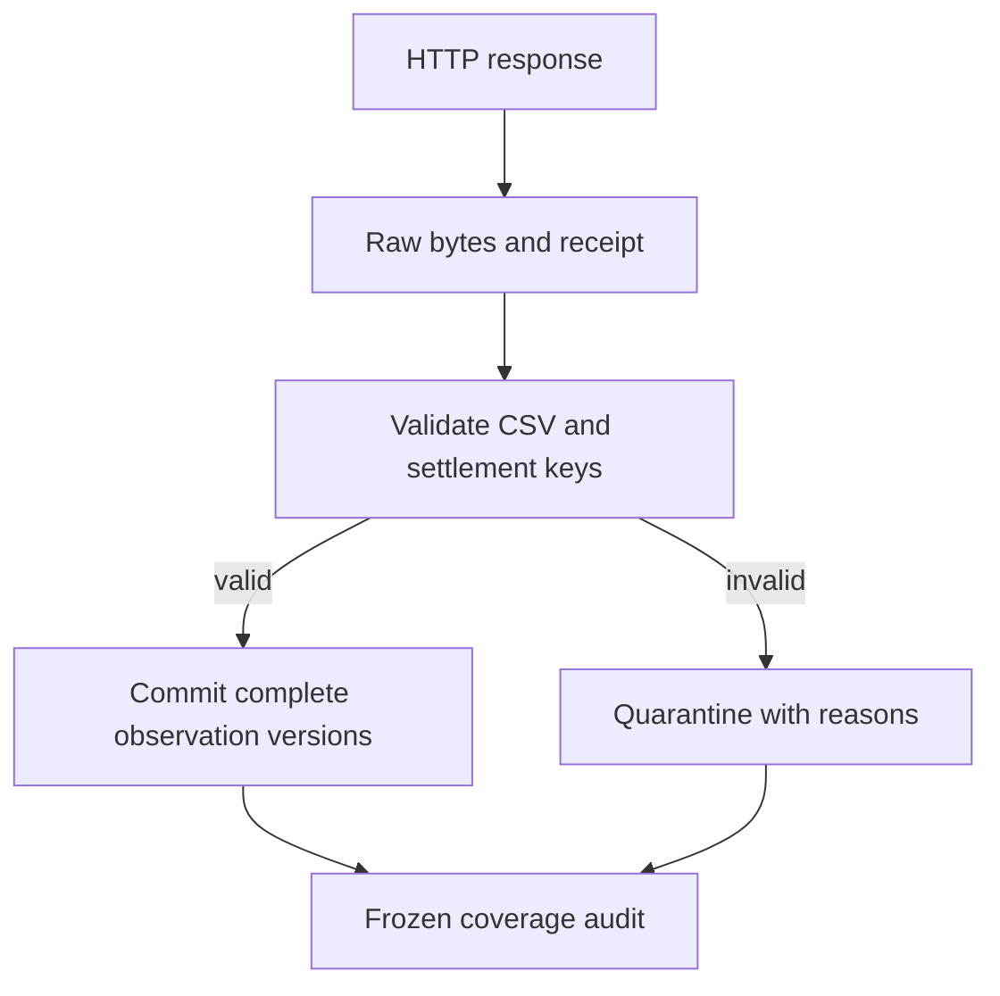

# Phase 2: turn provider files into trustworthy observation versions

The outcome is an audited data product, before any feature windows or model training. We downloaded the original NESO CSVs for 2017 through 2024 and a separate daily update. The annual files contain 140,256 unique half-hours, with complete National Demand coverage. The daily capture contains 2,415 actual rows; 321 forecast rows were excluded.

## 1. What are we predicting?

The target remains NESO National Demand, abbreviated ND, in MW. It is a particular generation requirement, not a direct measurement of every consumer's electricity use. TSD is a different demand measure. Estimated embedded wind and solar are separately named historical candidate covariates. Finding those columns does not authorise using their future values as inputs.

The [official NESO 2024 resource page](https://www.neso.energy/data-portal/historic-demand-data/historic_demand_data_2024) explains these definitions and settlement keys.

## 2. Preserve the evidence before interpreting it

A CSV is a sequence of bytes. SHA-256 produces a content identifier from those exact bytes. GridLens saves them under `raw/<sha256>.csv`, then records the retrieval URL, byte count, response headers, and UTC capture time.



If the same file arrives twice, there is one content object and two retrieval receipts. If a provider corrects 24,000 MW to 24,001 MW, the changed bytes get a different checksum and observation version. The original value remains available.

The filesystem publishes a complete temporary file atomically without overwriting an existing content object. SQLite commits the snapshot and all its canonical rows in one transaction. A failure during insertion rolls back that row set; the raw evidence and receipt intentionally survive. A test injects a database write failure to verify this behavior.

## 3. A date parser must have an explicit rule

The captured 2024 file uses `01-JAN-2024`. The 2023 file uses `01-Jan-23`. API-style ISO dates also appear in our inspected source material. We support those exact forms, without relying on the computer's language settings.

For a two-digit year, the annual resource supplies the century. `01-Jan-23` in the declared 2023 resource means 2023-01-01. Without a declared year, that form is rejected. A mismatched year is also rejected. This avoids an undocumented parser rule deciding between 1923 and 2023.

That source difference was detected by a complete-file audit: the initial parser quarantined the file. The reviewed interpretation has a new transform version, `neso_interval_v2`, so an old interpretation cannot silently change under the same snapshot identifier.

## 4. Why 46, 48, and 50 all occur

Settlement period 1 begins at midnight on the British local settlement date. British Summer Time changes the UTC offset. Elexon's [conversion table](https://www.elexon.co.uk/bsc/settlement/) defines ordinary, short, and long settlement days.

We first convert local midnight and the next local midnight to UTC. Their elapsed difference gives the number of half-hours. We then advance in UTC, where each half-hour is unambiguous:

`UTC start = UTC instant of local midnight + (period - 1) * 30 minutes`

For 2024-03-31, the UTC day span between local midnights is 23 hours, giving 46 periods:

| Period | British local start | UTC start |
| --- | --- | --- |
| 1 | 00:00 +00:00 | 00:00 |
| 2 | 00:30 +00:00 | 00:30 |
| 3 | 02:00 +01:00 | 01:00 |
| 4 | 02:30 +01:00 | 01:30 |

For 2024-10-27, it is 25 hours, giving 50 periods:

| Period | British local start | UTC start |
| --- | --- | --- |
| 1 | 00:00 +01:00 | 23:00 on the previous UTC date |
| 3 | 01:00 +01:00 | 00:00 |
| 4 | 01:30 +01:00 | 00:30 |
| 5 | 01:00 +00:00 | 01:00 |
| 6 | 01:30 +00:00 | 01:30 |

The two local 01:00 values represent different instants. Removing their offsets would destroy that distinction. A test checks continuity across every settlement interval from 2017 through 2024, and separate hand fixtures check the published transition mappings.

The conversion loads the installed, locked `tzdata` package directly. It does not depend on whichever timezone database happens to be installed on the host OS.

## 5. Play the conversion

Run the web application and open `/learn/settlement`. Select spring, autumn, or ordinary/leap day; click a period, drag the slider, or press **Play animation**. The active period moves while the local and UTC timestamps update. Nothing plays automatically. **Pause animation** stops movement; the controls work without motion.

The teaching fixture is exported by `scripts/export_settlement_demo.py` using the exact Python conversion above. CI checks that this export is fresh. A browser test verifies the spring jump, both occurrences of autumn 01:00, ordinary-day length, the animation, JavaScript errors, and horizontal overflow at desktop and mobile widths.

The model contract uses UTC target days, so its output remains 48 points. A local settlement day's length changes only the source-to-UTC conversion.

## 6. Actual demand and a forecast are different kinds of value

When `FORECAST_ACTUAL_INDICATOR` exists, `A` is eligible for the observation index and `F` is excluded. An unknown or blank indicator quarantines the snapshot. The daily-update resource must have this column. Annual outturn resources may omit it; their declared resource type supplies that interpretation. If an annual file includes the column, we respect it there too.

This prevents a provider's forecast from becoming a model's training label. The exclusion count is part of the frozen report, rather than being hidden in a cleaning notebook.

## 7. Gaps, duplicates, and quality checks

Blank numeric cells remain null. Missing ND reduces usable coverage. Phase 2 never fills targets or prepares scaled feature tensors. Missing intervals are counted against the whole settlement year, not merely against the first and last rows present in a file.

Exact duplicate rows collapse and are counted. Conflicting duplicates quarantine the complete snapshot. Incompatible numeric types, non-finite values, negative ND, invalid dates/ordinals, and missing columns also quarantine it. Extra columns are listed for review; they are not automatically promoted into model features.

Unusually large positive ND values remain unchanged. Zero ND and negative embedded generation produce explicit quality flags. For the captured annual files, those flag counts are zero. Wind and solar values are estimates as defined by the provider; the word actual here distinguishes outturn rows from forecast rows, not estimated generation from physical measurement.

## 8. What did the complete audit find?

| Settlement year | Expected | Accepted unique actuals | Missing ND slots |
| --- | ---: | ---: | ---: |
| 2017 | 17,520 | 17,520 | 0 |
| 2018 | 17,520 | 17,520 | 0 |
| 2019 | 17,520 | 17,520 | 0 |
| 2020 | 17,568 | 17,568 | 0 |
| 2021 | 17,520 | 17,520 | 0 |
| 2022 | 17,520 | 17,520 | 0 |
| 2023 | 17,520 | 17,520 | 0 |
| 2024 | 17,568 | 17,568 | 0 |

All eight years have zero missing values in the four audited numeric fields: ND, TSD, embedded wind generation, and embedded solar generation. Every spring/autumn transition has its expected period count. No duplicate conflicts or exact duplicates were found in these captures. Per-field ranges, columns, checksums, and exclusions are in [the frozen JSON audit](../../reports/neso-audit-v1.json). [Capture receipts](../../reports/neso-capture-receipts-v1.json) identify the original downloads and retrieval times.

## 9. A frozen audit is different from a live backtest

Annual files can be revised. Downloading them now does not reveal when their individual corrections were published in earlier years. These files support the explicitly labelled `retrospective_revised` experiment. `first_seen_at` means when a snapshot was captured; it is not an invented publication timestamp.

The observation index retains versions and supports a captured-time cutoff. Feature eligibility, origin windows, split ownership, and training-only scaling remain Phase 3 work. No model accuracy follows from passing a data audit.

## 10. Reproduce it

```bash
uv sync --frozen --no-dev
uv run --frozen --no-dev gridlens ingest-neso --sources 2017 2018 2019 2020 2021 2022 2023 2024 daily --report reports/local/live-audit.json
uv run --frozen --no-dev python scripts/check_live_ingestion.py --report reports/local/live-audit.json
```

The second command performs a new retrieval. The third verifies the stored bytes, observation counts, and equality with frozen annual checksums. A changed annual source requires review and a new freeze. Daily values may naturally change and are checked separately.

The initial local capture used Node's HTTP client because the restricted shell cannot reach the provider directly. `scripts/audit_captured_neso.py` imported those original bytes and receipts; it does not claim that Python performed those initial requests. The separate **NESO live data audit** Actions workflow exercises the Python HTTP adapter on a clean runner and preserves the complete raw data product for 30 days.

Supported by National Energy SO Open Data. [NESO licence](https://www.neso.energy/data-portal/neso-open-licence). GridLens is independent; NESO does not endorse it.
