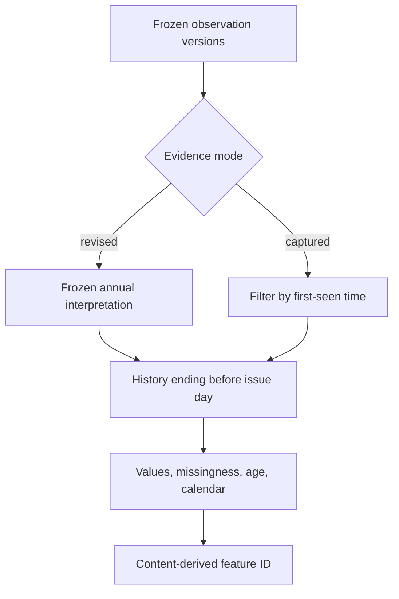

# Phase 3: freeze what each forecast is allowed to know

A complete CSV is only the starting point. A forecasting dataset must say which measurements were eligible at issue time, which day owns the labels, and which values fitted the scaler.

## Selection before tensors

The loader reads only the exact valid snapshot IDs in the frozen annual audit. A recently downloaded daily file cannot silently replace a historical training value. In `retrospective_revised` mode the selected annual files supply revised history. In `captured_availability` mode, the selector additionally requires `first_seen_at <= issued_at`. A later captured correction is excluded from an earlier issue.

For a target on January 6, issue is January 5 at 09:30 UTC. Context begins December 29 and ends at January 5 midnight, exclusive. The issue day's 48 intervals are skipped. The January 6 target contains 48 labels. Tests check those exact instants.

## Causal gaps and explicit feature order

The fixed order is ND, embedded wind, embedded solar; three missingness flags; three elapsed-age values in slots; then six deterministic UTC calendar features. Calendar pairs encode half-hour slot, weekday, and fraction of the year using sine/cosine. The calendar calculation is independent of demand and rounds to twelve decimal places before feature hashing.

Each history field may carry its last observed value forward by at most two half-hours. The original blank still has missingness 1 and age 1 or 2. No future observation supplies a fill. Up to two earlier eligible observations may seed the start of the context. A longer gap drops the origin with a field-specific reason. The optional histories do not silently disappear from one model's feature order.

Labels use a separately identified frozen truth version. One absent target ND value drops that origin; labels are never filled. Merely inspecting source completeness does not evaluate the held-out test.

## Scaling and split ownership

`Scaling.fit` accepts only the `point_train` role. It fits the three measurement channels using equal weight for every training-context slot, including repeated slots in overlapping windows. Missingness, age, and calendar retain their declared scales. Constant measurement channels use a small positive scale floor.

Target dates own splits, including dates whose origins are dropped. Overlap is rejected. The source hashes, valid target dates, aggregate feature and label hashes, scaling parameters, drop reasons, and evidence mode are frozen in `reports/dataset-freeze-v1.json`. Individual feature IDs can be regenerated from those exact source snapshots and conversion rules; the aggregate hash verifies the entire ordered sequence.

A feature ID describes the eligible feature content. The dataset ID additionally describes source lineage and label ownership. Changing only a future value leaves an earlier feature ID unchanged, while a genuinely different frozen source can create a different dataset identity.

## Evidence

Perturbation tests replace every issue-day and future value and require the earlier feature snapshot to remain identical. Other tests add an ineligible revision, create short/long gaps, remove a label, overlap split dates, and alter validation/test data while requiring the training scaler to remain unchanged. Repeated builds must reproduce the same report and IDs.

Run `uv run --frozen python scripts/build_dataset.py` after ingesting the frozen annual data. Model fitting starts in Phase 4. The final 2024 evaluation remains locked for its later predeclared comparison.
