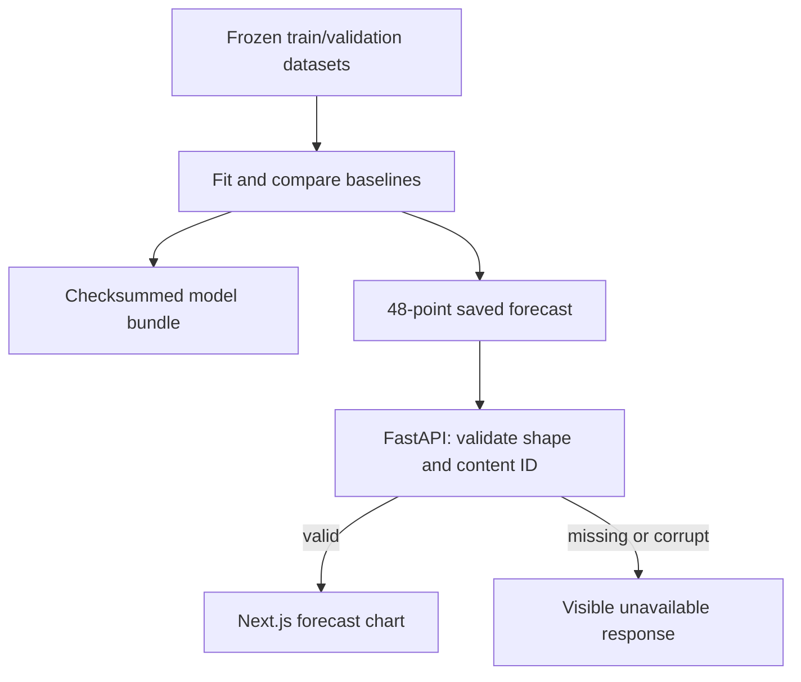

# Phase 4: a complete baseline forecast through the system

We now have a real forecast with a declared source, issue time, context cutoff, model version, and 48 outputs. Open `/forecasts` to compare saved last-day, weekly, and ridge forecasts for the validation target 2022-02-10. Green is the forecast; dashed grey is revised observed ND. The slot slider shows exact UTC time and MW values.

## The two persistence baselines

Persistence copies eligible historical measurements. Last-available-day persistence copies the final 48 context values. For issue day D, these are D-1, because D itself is excluded by the forecasting contract.

Weekly persistence copies the target day's same-slot measurement seven days earlier. The target is D+1, so its reference is D-6. Our context starts on D-7, making the correct array slice `[48:96]`. Tests use a numbered 336-value history to verify both slices exactly.

## Ridge regression

The input has 100 fixed features: 48 last-available-day values, 48 weekly reference values, and four target calendar features for weekday/year. Slot-specific outputs are separate columns, so the model predicts 48 values directly.

The training-only design matrix has one row per origin. Each feature is centred and scaled using 2018–2021 only. Targets are centred with a separate training mean for each output slot. The solution is:

`W = solve(Z.T @ Z + alpha * I, Z.T @ (Y - mean_Y))`

Predictions reverse the target centring. The intercept is not penalised because it is represented by the training target mean. We solve the system directly rather than computing a matrix inverse. All fitted arrays and training dataset identity are saved as JSON in a checksum-verified bundle; loading does not execute pickled Python code.

The predeclared penalties are 1, 10, and 100. Minimum 2022 validation RMSE selects 10. A label-maturity embargo removes the final origin of each fitting/selection role: a label released after the next role's first issue cannot train or select that earlier model. The training role retains 1,460 origins and point validation retains 364. Every candidate uses the same 364 origins, fixed labels, and evidence mode. The final 2024 test has not been evaluated.

| Baseline | MAE, MW | RMSE, MW |
| --- | ---: | ---: |
| Last available day | 2734.75 | 3646.32 |
| Weekly persistence | 2037.39 | 2807.36 |
| Ridge, alpha 1 | 1411.82 | 1916.25 |
| Ridge, alpha 10 | 1390.80 | 1895.45 |
| Ridge, alpha 100 | 1401.82 | 1913.63 |

These are selection-set results, not an unbiased final generalisation estimate. See [the saved report](../../reports/baseline-validation-v1.json) for all slot errors, daily peak errors, runtime, and model identities.

## Error definitions

MAE averages absolute point errors in MW. RMSE takes the square root of mean squared point error. Daily peak amplitude error compares the maxima of the predicted and observed curves. Peak timing error compares the earliest maximum slots, in half-hours. Hand-computed fixtures verify those definitions. Per-slot MAE/RMSE expose time-of-day differences rather than hiding them behind one average.

The report includes measured fit duration and prediction p50/p95. Prediction timing includes model-version hashing and output-contract validation; it is not presented as bare matrix-multiplication latency. Hardware, BLAS, and CPU scheduling affect timings, so the reference check compares errors within 1e-6 MW and records each runtime separately.

## Serving the immutable result

The packaged forecast contains the original input window, source hashes, model version, truth version, dataset ID, and content-derived forecast ID. It supplies one real historical validation example, not a live prediction service. FastAPI serves it without requiring PyTorch. A model selector requests the corresponding immutable forecast through Next.js's same-origin route.

Browser tests verify the real server response, all 48 points, exact issue/target/cutoff instants, the weekly lag values, visible provenance, mobile overflow, JavaScript errors, and API failure behavior. Unit tests verify save/load equality and corrupt-artifact rejection.

## Reproduce

Run `uv run --frozen --extra ml python -m scripts.run_baselines` after ingestion and the Phase 3 freeze. Override `--output`, `--forecast-output`, and `--bundle-root` to retain a separate rerun. `scripts/check_baseline_reference.py` verifies the resulting comparison without requiring bit-identical floating-point weights across operating systems.

The original small Transformer is constructed in Phases 5–6 and adapted to forecasting in Phase 7. These baselines form the reference it will need to beat.
