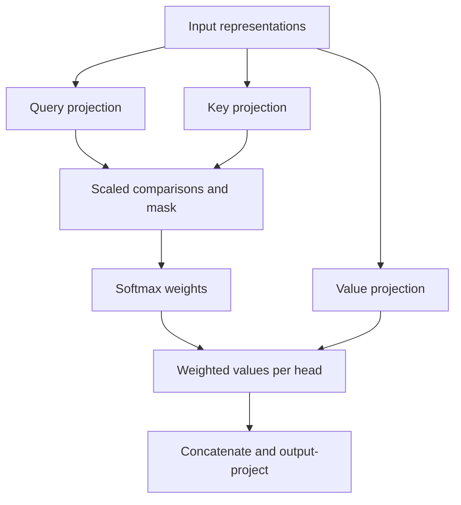

# Phase 5: attention and positions from first principles

The implementation is in `src/gridlens/models/attention.py`. It uses learned linear projections, matrix multiplication, explicit masking, softmax, dropout, and head concatenation. Production code does not call PyTorch's attention or Transformer layers. Built-in operators appear only as independent test oracles.

## One query, two keys

Take query [1,0], keys [1,0] and [0,1], and values [10,0] and [0,20]. The dot products are 1 and 0. Head width is 2, so the scaled scores are 1/sqrt(2) and 0. Softmax assigns approximately 0.66976 and 0.33024. The output is approximately [6.6976,6.6048]: a weighted combination of values.

A query describes a search, a key describes a candidate, and a value carries the information to mix. The scores choose weights; the values determine the resulting content. Scaling keeps wider dot products from making softmax unnecessarily sharp.

## Shape and head contracts

| Stage | Shape |
| --- | --- |
| Query input | B x Tq x d_model |
| Key/value input | B x Tk x d_model |
| Projected query | B x heads x Tq x d_head |
| Scores and weights | B x heads x Tq x Tk |
| Head output | B x heads x Tq x d_head |
| Merged output | B x Tq x d_model |

The module projects Q, K, and V separately, reshapes channels into heads, attends, then concatenates results and applies the output projection. Cross-attention permits different query/key lengths. Model width must be divisible by head count.

## One mask convention

Every public mask uses boolean true to mean blocked. A causal mask blocks future positions; a padding mask blocks padding keys. They broadcast to the score tensor and replace blocked scores with negative infinity before softmax. A query with no available keys raises an explicit error, rather than producing NaNs.

PyTorch's functional scaled-dot-product operator uses the opposite boolean convention, so the oracle test inverts the mask. PyTorch's MultiheadAttention oracle uses blocked-key booleans directly. We copy projection parameters into that independent module before comparing self/cross outputs and per-head weights.

Half-precision inputs accumulate scores and weighted values in float32 before returning the requested dtype. Finite input/score checks make numerical failures explicit. Dropout is active only in training mode.

## Positional encoding

For position pos and channel pair i, even channels use sin(pos / 10000^(2i/d_model)); odd channels use cosine of the same argument. Each pair changes at a different frequency. The implementation handles odd widths explicitly, stores a non-trainable persistent buffer, supports position offsets, and follows module device/dtype moves.

Attention compares content without inherently knowing order. Adding the positional pattern supplies that information. It does not make the buffer a learned parameter.

## Interactive calculations and animation

Open `/learn/attention`. Select a query and one of two heads, toggle the causal mask, and inspect scores, zeroed blocked weights, value mixing, and merged outputs. Play/pause advances the calculation stages and visits both heads. A separate positional animation displays eight channels across sixteen positions.

The three-token fixture uses identity Q/K/V/output projections so every displayed operation is inspectable. It illustrates the operators; its patterns are not learned explanations of an electricity model. An independent calculator exports the numbers, and CI compares them with the actual manual PyTorch modules. The attention check allows 1e-8 for the nine-decimal display fixture; positional values allow 1e-6 for float32 buffers. Critical operator/gradient parity tests use tighter float64 comparisons.

Browser tests compare the actual displayed numbers against that checked fixture, verify masks and animations, and check errors/overflow at desktop/mobile sizes. Animations are opt-in and transitions respect reduced-motion preferences.

## Correctness evidence

Tests cover a hand calculation, functional-operator output/gradient parity, multi-head oracle parity, different source/target lengths, future-token invariance, zero padding-key weights, fully blocked query rejection, numerical gradcheck, finite training gradients, evaluation dropout, known odd-width positions, offsets, buffer reload, and half precision. CUDA checks are conditional; CPU correctness is mandatory.

The complete original encoder/decoder and sequence training remain Phase 6. These operators are ready for those blocks.

References: [Attention Is All You Need](https://arxiv.org/abs/1706.03762), [PyTorch scaled attention](https://docs.pytorch.org/docs/2.14/generated/torch.nn.functional.scaled_dot_product_attention.html), [PyTorch multi-head attention](https://docs.pytorch.org/docs/2.14/generated/torch.nn.MultiheadAttention.html).
