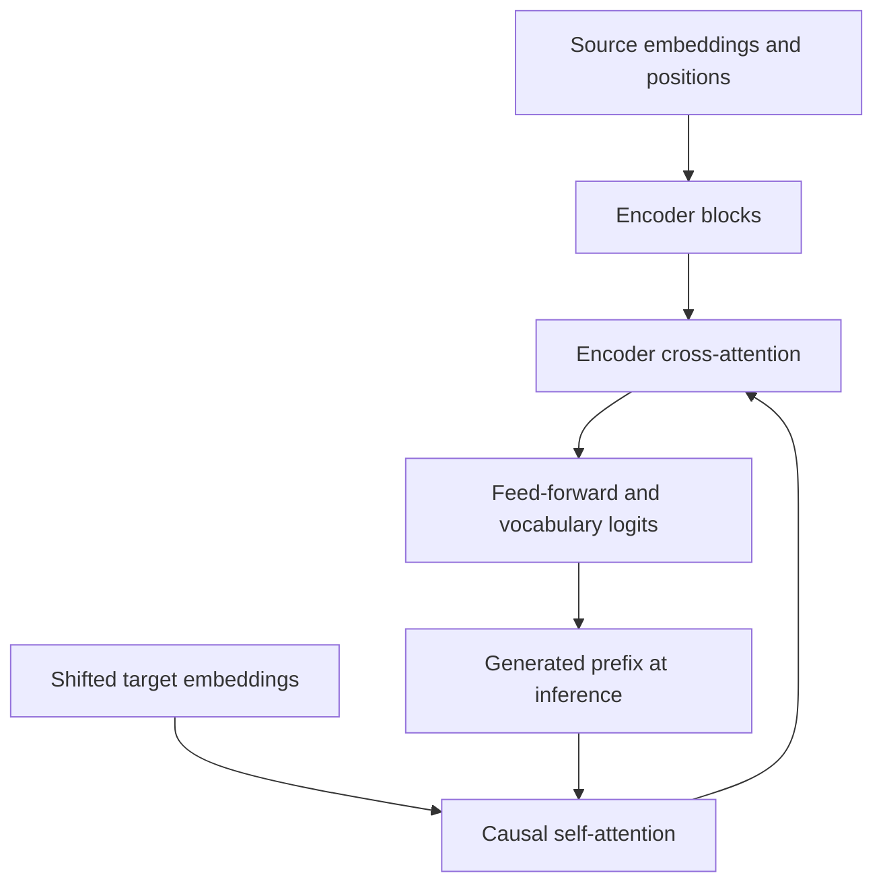

# Phase 6: the complete small Transformer

`models/transformer.py` builds on the checked manual attention operators. It never delegates attention or the architecture to `torch.nn.Transformer`.

An encoder block computes attention, adds the input residual, normalizes, then applies a position-wise two-layer ReLU network with another residual and normalization. This is the original **post-norm** order. Decoder blocks add a separate encoder cross-attention sublayer between masked self-attention and the feed-forward network. Source and target lengths may differ.

Tokens reserve PAD=0, BOS=1 and EOS=2. Training predicts `reverse(source), EOS` from `BOS, reverse(source)`; the causal mask blocks later decoder inputs, and source padding is hidden from encoder and cross-attention keys. PAD targets do not contribute to cross-entropy. Embeddings are scaled by sqrt(width), followed by sinusoidal positions and dropout. Shared source/target vocabularies support tying the output matrix to the embedding matrix.

Generation has no target argument. It encodes the source once and repeatedly decodes the generated prefix, suppressing BOS/PAD until EOS. Finished rows are padded and a hard maximum length bounds execution. Evaluation requires `eval()` to disable dropout.

The reproduction uses the planned 128-wide, four-head, two-encoder/two-decoder model with 512-wide feed-forward layers. Its bounded CPU run uses 2,400 batches of 64 random sequences, lengths 3–8, seed 17, Adam (0.9,0.98), epsilon 1e-9, gradient clipping and the original schedule shape with a deliberately shortened 200-step warmup. It evaluates 256 held-out same-length sequences and 128 longer sequences. Longer lengths are reported separately; success on this toy task does not reproduce translation results.

Tests check causal prefix invariance, source-padding invariance, unequal lengths, finite gradients, weight reload equality, generation bounds and schedule shape. The trained checkpoint is an Actions artifact, not a Git-embedded binary. The report records exact sequence accuracy, loss history, runtime and reload verification. Do not infer success from code presence: consult the measured report.

Open `/learn/transformer` for the shifted-input and generated-prefix walkthrough.
