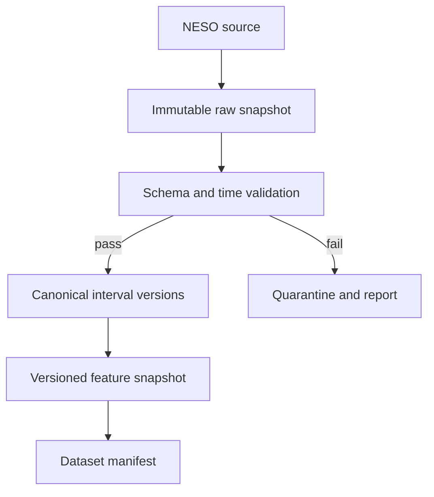
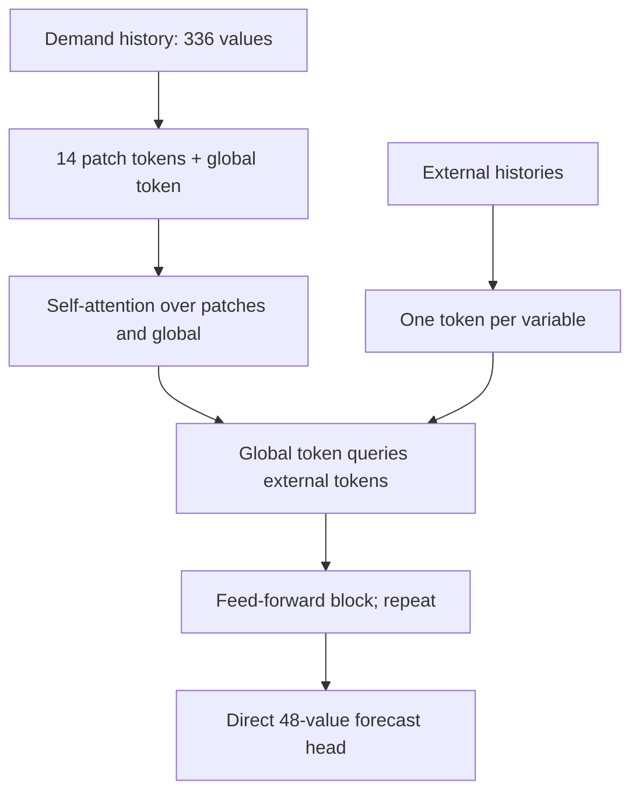
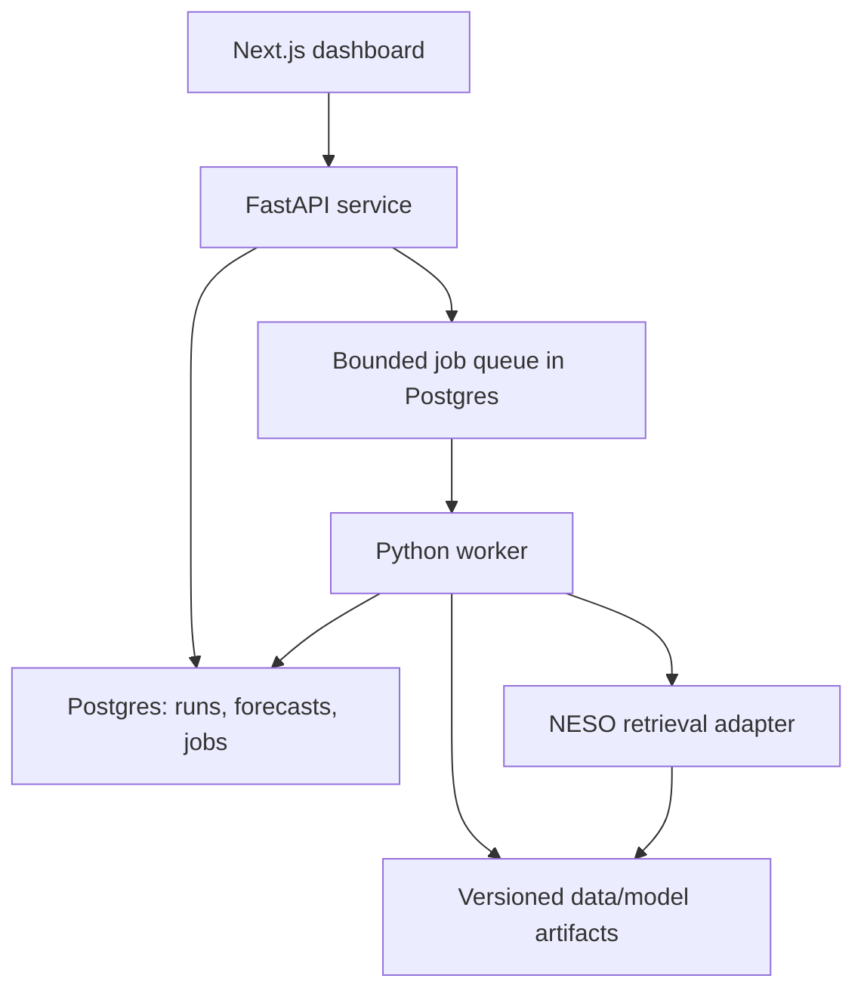
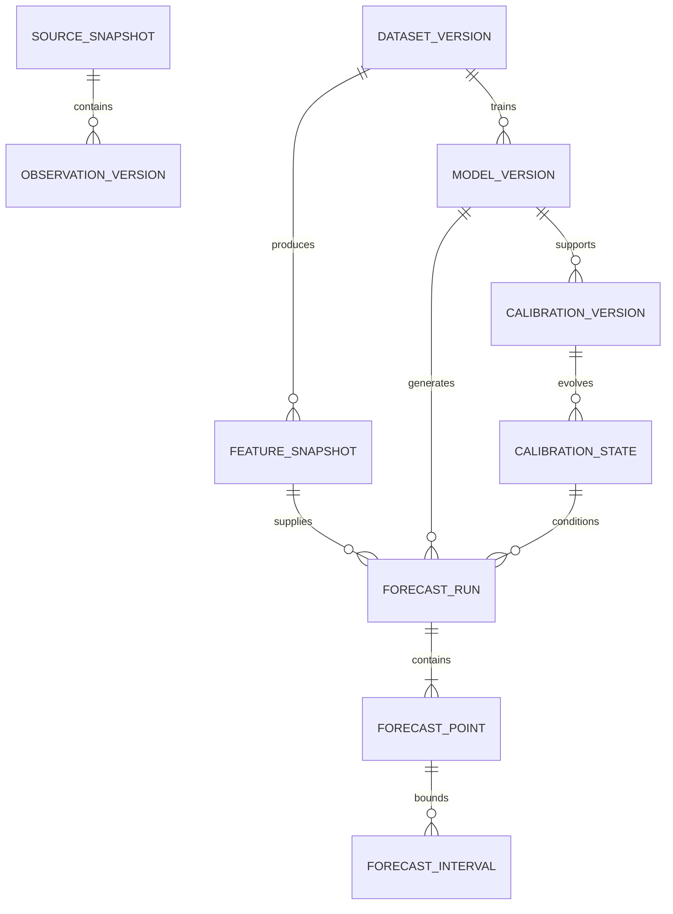
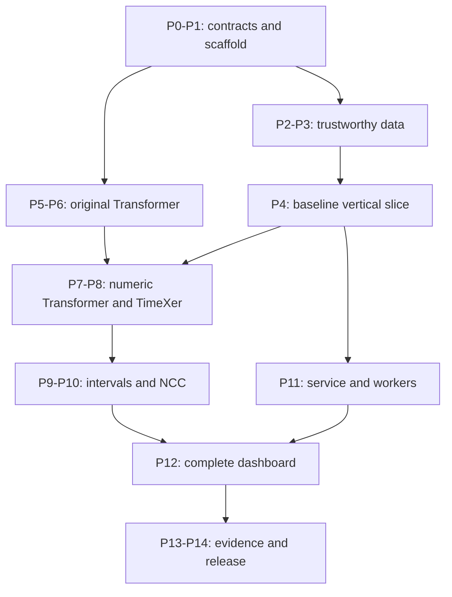

# GridLens

## Full product specification and phased implementation plan

**Version:** 1.0  
**Status:** Build specification; no implementation or performance results are implied.  
**Project:** Electricity demand forecasting with a Transformer implemented from scratch in PyTorch, an adaptation of TimeXer, and adaptive uncertainty from Neural Conformal Control.  
**Primary geography:** Great Britain.  
**Audience:** The developer building the system, technical reviewers, and recruiters assessing the finished project.

> GridLens answers three questions: What electricity demand do we expect tomorrow? How uncertain is that forecast? What evidence shows that the system is useful and reproducible?

---

## Contents

1. Product purpose and success criteria
2. Scope, release boundaries, and assumptions
3. User journeys and application behaviour
4. Research foundations and reproduction boundaries
5. The exact forecasting contract
6. Data sources, availability, and evidence modes
7. Ingestion, cleaning, and feature engineering
8. Dataset construction and chronological splits
9. Transformer implementation from first principles
10. Electricity forecasting models and TimeXer adaptation
11. Prediction intervals and Neural Conformal Control
12. Training and experiment management
13. Evaluation, baselines, and ablations
14. Architecture and technology choices
15. Storage model and database relationships
16. API and background job contracts
17. Dashboard and interaction specification
18. Learning guide, diagrams, and animations
19. Reliability, security, and observability
20. Testing and acceptance strategy
21. Compute, performance, and cost controls
22. Repository structure and developer commands
23. Phased implementation plan
24. Dependency map and effort estimates
25. Requirements traceability
26. Risks, unresolved decisions, and fallbacks
27. Final deliverables and release checklist
28. Portfolio presentation and claim rules
29. Worked examples
30. References and terminology

---

## 1. Product purpose and success criteria

### 1.1 Problem

Electricity demand changes through the day and across weekdays, holidays, and seasons. A point forecast describes one expected outcome. It does not describe the range of plausible outcomes or reveal when the model is performing poorly. GridLens provides a forecast, prediction intervals, historical comparisons, and a reproducible record of how each output was produced.

The initial user is an analyst exploring demand patterns and forecast reliability. The project is an engineering demonstration for decision support. It does not perform dispatch, buy electricity, control grid equipment, or make trading recommendations.

### 1.2 Product promise

Given a model bundle and a documented snapshot of eligible input data, GridLens produces one forecast for every half-hour of the following UTC day. It records the issue time, input cutoff, target definition, model version, dataset version, and calibration state. A user can replay historical forecasts without silently revealing future observations to the model.

### 1.3 What expertise the finished project should demonstrate

- Implementing and explaining multi-head attention, positional encodings, encoder and decoder blocks, masking, and training in PyTorch.
- Reading published methods and distinguishing faithful reproduction from application-specific changes.
- Building a temporal data pipeline with revision history, availability constraints, validation, and lineage.
- Evaluating accuracy and uncertainty with chronological holdouts and meaningful baselines.
- Serving versioned model outputs through a typed API and usable dashboard.
- Handling retries, partial failures, concurrent workers, bounded workloads, and database migrations.
- Communicating results through diagrams, animations, a model card, and a reproducible demonstration.

### 1.4 Completion criteria versus performance ambitions

**Completion requirements** are mandatory: correct models, no known leakage, reproducible splits, functional API and UI, recorded experiments, documented limitations, and passing critical tests.

**Performance ambitions** are targets to investigate: lower MAE than the strongest simple baseline; useful prediction intervals; acceptable CPU latency. A neural model is not promoted simply because it is more complex. If ridge regression wins, GridLens serves ridge as the champion while retaining the Transformer experiments and explaining the result.

The initial comparison ambition is at least 5% lower aggregate MAE than weekly seasonal persistence on validation. This is a project target, not a forecast of the eventual result. Model selection uses the strongest eligible baseline, not only the easiest baseline to beat.

---

## 2. Scope, release boundaries, and assumptions

### 2.1 Required final scope

| Area | Included |
| --- | --- |
| Learning implementation | Original small encoder-decoder Transformer; manual attention and sinusoidal positions; sequence learning demonstration |
| Forecasting | Great Britain National Demand, half-hourly, fixed 48-point target day |
| Models | Persistence baselines, ridge regression, LSTM, original-style numeric Transformer, TimeXer adaptation |
| Uncertainty | Fixed residual intervals, rolling residual intervals, NCC application adaptation |
| Data | Immutable raw snapshots, canonical UTC intervals, feature snapshots, validation reports |
| Evaluation | Chronological backtest, horizon metrics, peak metrics, interval metrics, ablations, measured runtime |
| Application | Forecast explorer, replay, comparison, reliability, data health, model internals |
| Engineering | FastAPI, worker, Postgres, migrations, reproducible artifact bundles, CI, containerised local stack |
| Documentation | Full walkthrough, mathematical examples, interactive visualisations, model/data cards, demo script |

### 2.2 Staged releases

**R0 - trustworthy vertical slice:** validated dataset, seasonal baseline, forecast artifact, API response, and simple forecast chart. This makes later work observable.

**R1 - explainable Transformer release:** manual Transformer, numeric forecasting adaptation, training/evaluation harness, point forecast comparisons, and learning visuals.

**R2 - full GridLens release:** TimeXer adaptation, NCC, interval comparisons, robust replay, data lineage, operational checks, and complete portfolio evidence. This is the intended final scope.

**Optional extensions:** archived weather forecasts, additional demand regions, live snapshot collection, operator forecast comparison after alignment checks, and cloud hosting. These are not dependencies for R2.

### 2.3 Explicit exclusions

No foundation-model training, LLM-generated operational explanations, autonomous energy trading, equipment control, invented research architecture, or claims to reproduce original WMT translation scores. No Kubernetes, Kafka, distributed training, or GraphQL requirement: the initial traffic and data volume do not justify them.

### 2.4 Assumptions

One developer; CPU development environment; optional access to one modest GPU; Python and TypeScript; public source data; single national target; daily forecast origins. Versions are pinned during environment setup after compatibility checks, rather than guessing future library versions in this document.

No paid external API is required. Historical source coverage and licence obligations must pass the data audit before the full training run. Hosting is separately configurable and has no assumed budget commitment.

---

## 3. User journeys and application behaviour

### 3.1 Inspect a forecast

1. Open the forecast explorer.
2. See the selected issue date, target day, model, evidence mode, and data freshness.
3. Read demand in MW over 48 half-hour intervals, with 80%, 90%, and 95% prediction bands where available.
4. Inspect the largest predicted demand, its time, and the input cutoff.
5. Hover over an interval to inspect its exact time range, point forecast, bounds, and later actual observation if it has arrived.
6. Open provenance to inspect the model bundle, raw snapshot references, and calibration version.

### 3.2 Replay history

1. Select an available historical issue date and evidence mode.
2. The server loads or computes the forecast using the permitted feature snapshot.
3. The chart initially hides future actual observations.
4. Play advances a simulated clock. Predictions stay fixed; actuals become visible only at the configured release event.
5. Calibration state changes only when new actuals become eligible, never because the UI cursor moved across an unreleased timestamp.
6. The user compares forecast error and interval performance as the replay advances.

### 3.3 Compare models

Select models already evaluated on the same dataset, origin schedule, target, and truth version. Inspect MAE, RMSE, peak error, interval score, coverage, latency, and parameter count. An incompatible experiment is shown as incompatible instead of being ranked beside the others.

### 3.4 Understand a model

Open a learning panel showing a small numerical example. Step through embeddings, positions, queries/keys/values, head splitting, attention weights, and output projection. A second panel shows actual model attention for a selected forecast and clearly distinguishes this diagnostic view from causal explanation.

### 3.5 Inspect degraded service

If the latest data is incomplete, the system displays the last successful forecast with its original timestamps. If a forecast is unavailable, it explains which requirement failed. A fallback baseline forecast carries its own model identity. A missing interval estimate is displayed as missing, never replaced with a fabricated narrow band.

---

## 4. Research foundations and reproduction boundaries

### 4.1 Three papers, each with a clear role

| Foundation | Role | Required implementation evidence |
| --- | --- | --- |
| Attention Is All You Need, 2017 [R1] | Foundational encoder-decoder architecture and attention | Manual scaled dot-product and multi-head attention; positions; masks; residuals; norms; full encoder/decoder |
| TimeXer, NeurIPS 2024 [R2] | Handling target history and external histories differently | Target patches, learned global token, variable tokens, self-attention and global-to-exogenous cross-attention |
| Neural Conformal Control, AAAI 2025 [R3] | Adaptive prediction intervals | Neural score quantile predictor, control signals, paper-specific losses, conformal adjustment, monotonicity handling |

TimeXer and NCC are the only additional research methods adopted. Ordinary baselines, standard metrics, and engineering tools do not add further research architectures.

### 4.2 Keep the foundational implementation separate

The original model module uses the paper's post-normalisation order, ReLU feed-forward blocks, sinusoidal positional encodings, token embeddings scaled by the square root of model width, and masked decoder self-attention. It runs a small discrete sequence task before numerical forecasting is introduced.

The electricity adaptation uses numeric projections and a regression head. TimeXer uses its own published token arrangement. NCC is a separate component around forecast residuals. These are separately named modules and separate experiment IDs.

### 4.3 What counts as from scratch

Allowed: PyTorch tensors, matrix multiplication, autograd, Linear, LayerNorm, Dropout, Embedding, optimisers, and GRU cells/layers for NCC or the LSTM baseline.

Not allowed in the authoritative attention/Transformer implementation: `nn.Transformer`, `nn.TransformerEncoder`, `nn.TransformerDecoder`, `nn.MultiheadAttention`, pretrained model imports, or delegating attention computation to a fused attention function.

PyTorch's attention implementation may be used as a test oracle and optional measured deployment optimisation after manual correctness is established. Optimised and manual results must have distinct implementation labels and numerical parity checks.

### 4.4 Research traceability

Maintain `docs/research_mapping.md`: paper section/equation, local class/function, related test, and deliberate deviation. Pin official repository commits for reference; do not copy code without checking its licence. A missing licence is a reason to implement the published method independently and clarify reuse rights, not to assume permission.

This project reproduces selected methods and adapts them to a new application. It does not claim a novel algorithm or automatic transfer of a paper's benchmark results or theoretical guarantees.

---

## 5. The exact forecasting contract

### 5.1 Target

Target field: **National Demand (ND)** in MW as defined by NESO [R4]. This is a particular metered generation requirement; it must not be described as all electricity consumed by all end users. Do not silently substitute Transmission System Demand (TSD) or add embedded solar and wind to change the target.

One target value describes a half-hour interval. Store interval start and interval end in UTC, with half-open interval semantics `[start, end)`.

### 5.2 Default issue schedule

| Item | Fixed default |
| --- | --- |
| Issue time | 09:30 UTC on issue day D |
| Target | All intervals starting from 00:00 UTC on D+1 through 23:30 UTC on D+1 |
| Number of outputs | 48 |
| Last eligible observed interval end | 00:00 UTC on D |
| Historical context | 336 consecutive intervals: seven complete UTC days ending at that cutoff |
| Deliberate gap | The 48 intervals of issue day D are absent from historical demand inputs |
| Initial exogenous context | Same seven-day history as target context |
| Prediction bands | 80%, 90%, and 95% marginal intervals |
| Origin frequency | One origin per day |

This schedule is a project design. NESO's daily update is usually published by 08:30 UTC [R5], but actual completeness must be checked at run time. The buffer is not proof of availability.

If the prior complete UTC day is not available at 09:30, the run fails validation or waits within a bounded grace period. It does not move the cutoff or borrow observations from another source without creating a different, explicitly named contract.

### 5.3 Distinguish output slot from lead time

`horizon_index` is 0 through 47 within the target day. `lead_minutes` is target interval start minus issue timestamp. The first prediction is 14.5 hours after issue; the final interval starts 38 hours after issue and ends 38.5 hours after issue.

The model is therefore not simply forecasting the next 48 observations after its last input. It forecasts a 48-point day after a 48-point gap. Every sampler, baseline, decoder, calendar feature, and chart must obey this gap.

### 5.4 Required temporal fields

Every forecast contains `issued_at`, `context_start`, `context_end_exclusive`, `input_cutoff`, `target_start`, `target_end_exclusive`, `source_snapshot_id`, `feature_snapshot_id`, `evidence_mode`, `truth_policy`, and `contract_version`.

Use timezone-aware timestamps. Derived local labels use Europe/London, but storage, joins, and target lengths use UTC. The target is a UTC day, not necessarily a British civil day.

---

## 6. Data sources, availability, and evidence modes

### 6.1 Source inventory

| Source | Initial use | Important condition |
| --- | --- | --- |
| NESO Historic Demand Data [R4] | Multi-year retrospective training and evaluation | Delayed publication and retrospective corrections; not an issue-time archive |
| NESO Demand Data Update [R5] | Prospective snapshot collection and actual release events | Mixed actual/forecast indicators; latest contents can overwrite earlier values |
| Deterministic calendar | Time-of-day and weekday features; target timestamps | Always computable at issue time; holiday jurisdiction must be explicit |
| NESO day-ahead demand forecasts [R6] | Optional external comparison | Cardinal points and target semantics may not match 48 interval averages |
| Archived forecast weather | Optional later extension | Forecast issue time must precede GridLens issue; observed future weather is prohibited |

Retain source URLs, resource IDs, schema descriptions, retrieval timestamps, checksums, and licence attribution. The source licence is available via NESO's portal [R7]; verify current obligations at data-ingestion implementation.

### 6.2 Mode A: retrospective revised-data experiment

Historical annual files do not reconstruct exactly what an operator knew at a historical issue time. In this mode:

- Enforce event-time cutoffs, target gaps, chronological splits, and training boundaries.
- Use one frozen download of historical revised values.
- Identify the dataset as revised historical data.
- Record that historical availability of each individual revision is unknown.
- Do not describe results as a fully live-faithful backtest.

This mode supports training and a credible retrospective comparison, provided all compared models use the same data.

### 6.3 Mode B: captured-availability replay

Start collecting immutable source snapshots prospectively. `first_seen_at` is the first successful retrieval timestamp, not an invented source publication time. Select only versions first seen at or before issue. If a trustworthy source issue timestamp exists, retain it too, but retrieval remains separately recorded.

This mode supports stronger availability claims after enough observations have accumulated. Historical origins before collection began remain in Mode A unless an authentic vintage archive is obtained.

### 6.4 Truth policies

Maintain two separate roles for actual demand:

1. **Operational feedback truth:** the first eligible actual observation captured after target completion. Used to update calibration state.
2. **Evaluation truth:** a frozen, identified version of actual values. Used to produce comparable final metrics, potentially after corrections.

Revisions can change evaluation metrics, but they must not rewrite the state that produced a previously issued forecast. Recomputing historical results under a revised truth creates a new evaluation run.

### 6.5 Availability invariant

For captured-availability replay, every non-deterministic feature must satisfy `first_seen_at <= issued_at`. Forecast-valued features additionally require `source_issued_at <= issued_at`. Observed historical inputs must end at or before the contract cutoff. A future target value can never appear in a feature tensor.

### 6.6 Future weather decision

R2 does not require weather. Start with demand history, historical embedded generation where available, and calendar features. If archived weather is later added, use a small documented set of geographic locations and fixed weighting; retain weather model identity, forecast run time, valid time, and retrieval time. Weather reanalysis may be an explicitly labelled oracle experiment, but never a production-equivalent comparison.

---

## 7. Ingestion, cleaning, and feature engineering

### 7.1 Pipeline



### 7.2 Retrieval

Use one source adapter per dataset. Discover and pin a chosen resource, while retaining enough metadata to detect upstream changes. Configure HTTP timeouts, respect published rate limits, and retry transient failures with bounded exponential backoff and jitter. Respect `Retry-After`. Invalid CSV, authentication errors, and schema changes are not retried indefinitely.

Compute SHA-256 before parsing. Store raw bytes and response metadata first. Validation failure never destroys the raw response. An identical checksum is idempotent and does not create a duplicate content object; a later retrieval event can still be recorded.

### 7.3 Schema validation

Require settlement date, settlement period, and ND. Treat extra columns as additive changes and log them. Missing required columns or incompatible types quarantine the snapshot. Maintain an explicit mapping from upstream names to canonical fields, rather than fuzzy matching a similar column.

When `FORECAST_ACTUAL_INDICATOR` is present, only actual records supply labels or historical observed inputs. Predicted generation and actual generation are separately typed values even if the upstream file places them in adjacent rows.

### 7.4 Settlement-time conversion

Settlement periods are indexed within British settlement dates, while the model uses UTC intervals. Build each local day's actual half-hour timeline using timezone rules, then map settlement period ordinal to UTC. Do not assume every local day has 48 periods. Spring transitions have 46 and autumn transitions 50.

Check conversion against source-specific documentation and known transition fixtures. The canonical UTC grid remains continuous and unique. Store the original settlement date/period alongside each converted interval for audit.

### 7.5 Duplicates, gaps, and revisions

- Duplicate rows with identical keys and values collapse within a snapshot.
- Conflicting duplicates fail validation unless an explicit source revision field resolves them.
- Later snapshots with changed values create a new observation version.
- A missing ND label excludes that target origin from metrics; never interpolate evaluation targets.
- Short historical feature gaps may use causal forward fill for at most two half-hours, with a missingness indicator and elapsed-age feature.
- Longer gaps reject the origin or activate a separately named reduced-feature model.
- Do not backward fill, use centred interpolation, or fit imputation parameters on validation/test.

No automatic clipping of unusually high demand. Outliers can be valid peaks. Impossible values or suspicious changes are flagged by configurable quality checks and investigated. Record exclusions and their counts.

### 7.6 Feature groups

| Group | Fields | Eligibility |
| --- | --- | --- |
| Endogenous history | ND and missingness | Historical only, through context end |
| External histories | Embedded wind and solar estimates; optional other audited fields | Same historical cutoff; own value/version metadata |
| Historical calendar | Sine/cosine half-hour-of-day and weekday; weekend flag | Computable from timestamps |
| Future calendar | Target UTC/local timestamps, cyclical time features, weekend flag | Known at issue time |
| Optional holiday | Explicit England/Wales, Scotland, or combined flags | Deterministic published calendar; national aggregation choice documented |
| Quality | Missingness, age, source mode | Available with the selected snapshot |

Treat TSD and other related demand measures cautiously: they may be redundant with ND. Include them only as audited historical covariates in an ablation, never as same-time future features.

### 7.7 Scaling

Fit per-field mean and standard deviation on the training period only. Save feature order, units, means, standard deviations, and constant-field handling in the model bundle. Inverse-transform predictions before publishing MW metrics.

For a TimeXer reference configuration that uses per-window normalisation, compute statistics only from the input context and record this as a model configuration. Compare global and input-window scaling only as a declared ablation; never compute scaling from the target day.

---

## 8. Dataset construction and chronological splits

### 8.1 Initial proposed periods

| Role | Proposed range | Permitted use |
| --- | --- | --- |
| Point-model training | 2018-01-01 to 2021-12-31 | Fit model weights and global scalers |
| Point-model validation | 2022-01-01 to 2022-12-31 | Hyperparameters, early stopping, model selection |
| Calibrator development | 2023-01-01 to 2023-06-30 | Train NCC using genuinely out-of-sample point predictions |
| Calibrator validation | 2023-07-01 to 2023-09-30 | Choose NCC hyperparameters and training checkpoint |
| Calibration initialisation | 2023-10-01 to 2023-12-31 | Initialise frozen residual/controller state |
| Locked final test | 2024-01-01 to 2024-12-31 | One final predeclared comparison |
| Optional later-period check | 2025, subject to coverage audit | Separate robustness run after primary decisions are frozen |

Assign origins by target day. These dates are proposed defaults and must pass source completeness checks. If data coverage forces a change, revise and freeze the manifest before looking at model outcomes. Never choose years because a preferred model performed better there.

The point model selected after 2022 stays fixed through calibrator development and the main test. Retraining it later invalidates old calibration residuals; a new model needs new out-of-sample calibration and a different experiment identity.

### 8.2 Window construction

For target date T, issue is T-1 at 09:30 UTC. Context ends at midnight at the start of T-1. The context contains 336 intervals; the intervening issue day contributes no observed target values. The label is the 48 intervals of T.

The sampler stores origin IDs, context indices, gap length, label indices, feature schema, and validity masks. Shuffle training origins only after constructing valid chronological windows. Validation and replay remain ordered.

Historical context may cross a split boundary because it would already be known. Labels may not straddle split ownership. The last training target interval must precede the first validation target interval. Any rolling-origin variant documents its retraining schedule and excludes future labels at each origin.

### 8.3 Dataset manifest

Required contents: manifest version, source snapshot checksums, canonical schema version, transform configuration, timezone rules/version, target definition, forecast contract, split ranges, valid origin IDs, dropped-origin reasons, feature order, scaler hash, data evidence mode, and evaluation truth policy.

Create a content-derived dataset ID from canonical manifest content. Repeated builds from identical bytes and configuration produce the same ID. Store counts before and after each validation step.

### 8.4 Data audit gate

Do not begin full training until the audit reports coverage by year, missing intervals, duplicate conflicts, DST conversion checks, feature availability, actual/forecast discrimination, and source revision limitations. A small synthetic fixture can unblock model unit tests while real data issues are resolved, but cannot supply headline performance claims.

---

## 9. Transformer implementation from first principles

### 9.1 Core attention equation

\[
\operatorname{Attention}(Q,K,V)=\operatorname{softmax}\left(\frac{QK^T}{\sqrt{d_k}}+M\right)V.
\]

Queries represent what each position is looking for; keys describe candidate positions; values carry the information to combine. The mask M excludes forbidden comparisons. The explanation must include a hand-computed example with two or three tokens before introducing batches.

### 9.2 Tensor contract

| Tensor | Shape |
| --- | --- |
| Query input | B x Tq x d_model |
| Key/value input | B x Tk x d_model |
| Projected split queries | B x heads x Tq x d_head |
| Attention scores | B x heads x Tq x Tk |
| Attention weights | Same as scores |
| Per-head output | B x heads x Tq x d_head |
| Concatenated output | B x Tq x d_model |

Require `d_model % heads == 0`. Self-attention has Tq=Tk; cross-attention need not. Mask API uses a single documented convention: boolean true means blocked. Convert to additive negative infinity internally. Reject a valid query row with no available keys; do not silently propagate NaNs.

### 9.3 Positional encodings

\[
PE(pos,2i)=\sin\left(pos/10000^{2i/d_{model}}\right),\qquad
PE(pos,2i+1)=\cos\left(pos/10000^{2i/d_{model}}\right).
\]

Implement encodings as non-trainable buffers with correct device/dtype movement. Handle odd model widths deliberately, although the default is even. Explain how each position gets a distinct multi-frequency pattern and why attention alone does not know sequence order.

### 9.4 Encoder and decoder

Encoder block: self-attention, residual/dropout/post-LayerNorm, feed-forward ReLU, residual/dropout/post-LayerNorm. Decoder block adds causal self-attention and encoder-decoder cross-attention before the feed-forward sublayer.

Padding masks exclude padding keys. Loss ignores padded target tokens. Causal masks prevent a decoder position from reading later target inputs. Shift target tokens by one position for training. Generation starts from BOS and stops at EOS or a bounded maximum length.

### 9.5 Small reference configuration

| Parameter | Default |
| --- | --- |
| Encoder layers / decoder layers | 2 / 2 |
| Model width | 128 |
| Attention heads | 4 |
| Head width | 32 |
| Feed-forward width | 512 |
| Dropout | 0.1 |
| Sequence task | Reverse variable-length integer-token sequences with BOS/EOS/PAD |
| Optimiser experiment | Adam with original-style warmup schedule |

Weight tying is supported when input/output vocabularies match. This is a small architecture reproduction, not reproduction of the paper's dataset scale or translation results.

### 9.6 Correctness evidence

Require manual-vs-reference attention parity with dropout disabled; blocked future-token invariance; zero attention on padding keys; self/cross attention shape tests; finite gradients; state-dict save/load equivalence; and successful tiny-batch overfitting.

Sequence-task quality target: at least 95% exact sequence accuracy on a held-out set drawn from the training length range, subject to a fixed training budget. Report longer-length generalisation separately. Failure at longer lengths is useful evidence and must not be hidden.

---

## 10. Electricity forecasting models and TimeXer adaptation

### 10.1 Baseline interfaces

All models implement `fit`, `predict`, `save_bundle`, and `load_bundle` against the same dataset contract. `predict` returns exactly 48 finite MW values or a typed failure. An adapter may translate between sklearn and PyTorch models, but output semantics remain identical.

Required point models:

1. Last available complete UTC day's same-slot demand.
2. Weekly seasonal persistence: target slot minus seven days.
3. Ridge regression using a declared, fixed set of eligible lagged demand/calendar features.
4. Small LSTM using historical context and a direct 48-output head.
5. Original-style numeric encoder-decoder Transformer.
6. TimeXer application adaptation.

The last-day baseline is deliberately a last-available-day baseline; it cannot use issue-day demand. The weekly baseline verifies that its reference intervals actually lie inside available history.

### 10.2 Numeric encoder-decoder

Replace token embeddings with learned projections of numerical feature vectors. Encoder inputs contain eligible historical measurements and calendar information. Decoder inputs contain target calendar features and a shifted target-demand scalar during training. The initial demand scalar uses a learned start representation.

At inference, each decoder step consumes the previously generated demand value, not the true value. Report end-to-end autoregressive latency. All validation and test forecasts use inference-mode generation; teacher-forced validation loss is supplementary only.

Supply target calendar features and explicit lead/gap information so the model knows it is predicting beyond the missing issue day. Do not pretend adjacent decoder positions are adjacent to the final observed interval.

### 10.3 TimeXer token arrangement

The application design follows the selected TimeXer method [R2]. A seven-day ND context is divided into non-overlapping patches. Each patch is projected into a token. Append a learned global target token. Each external history is projected into one variable token.

Default patch length: 24 half-hours, giving 14 patches from 336 observations. Model width 128, four heads, three blocks, feed-forward width 512. A smaller two-block configuration is available for development. These are project defaults to validate, not the paper's universal optimum.



The global token, rather than every patch independently, queries external variable tokens. Later self-attention distributes that information across patch representations. This detail distinguishes the chosen method from generic concatenation of all input values.

### 10.4 Explicit application changes

- Forecast output starts after the contract's 48-interval gap rather than immediately after context.
- The direct head emits the target UTC day's 48 outputs.
- A small target-calendar projection may be concatenated with the final representation before the regression head. This is an application adapter, not an unmodified TimeXer reproduction.
- Missingness inputs, feature-age signals, and source availability enforcement belong to GridLens's data adapter.
- Any deviation in normalisation, activation, patch positional encoding, or head pooling is named in configuration and tested as an ablation if it affects comparison.

Before implementing the application changes, reproduce the reference TimeXer forward structure on a synthetic, gap-free tensor fixture. Compare operator order and shapes with a pinned official code reference. Do not label the application model an exact paper benchmark reproduction.

### 10.5 Training loss and output handling

Initial point loss is MSE on scaled ND. Select checkpoints using validation MAE in MW. Keep MAE-based training as a bounded optional experiment. Do not clip negative forecasts merely to improve scores: if non-negative projection is used, define it in the model configuration and apply it consistently to served and evaluated outputs.

The primary forecast is a regression point estimate; it is not automatically the mean of a calibrated probability distribution.

---

## 11. Prediction intervals and Neural Conformal Control

### 11.1 Meaning of the bands

A nominal 90% marginal prediction interval aims to contain the corresponding actual demand value roughly 90% of the time across evaluated cases. It does not mean a 90% guarantee for each specific interval, nor a 90% guarantee that all 48 points of tomorrow's curve will lie inside their bands.

The UI uses the term prediction interval, not confidence interval for the mean. Coverage is always reported alongside interval width and score: trivially wide intervals can achieve high coverage.

### 11.2 Initial residual methods

For origin o and output slot h, define `s[o,h] = abs(actual[o,h] - forecast[o,h])` in MW. Fit fixed residual quantiles from the calibration initialisation period. Compute the empirical quantile using the finite-sample rank `ceil((n+1)*(1-alpha))`, with an explicit insufficient-sample policy. These are empirical residual bands for temporally dependent data; do not claim ordinary exchangeable split-conformal guarantees.

Rolling residual intervals update using only matured feedback. Initial window length is 90 eligible target days per slot. Minimum history is 60 days. If sample count is insufficient, use a declared pooled residual fallback and set a degraded calibration flag.

Use symmetric intervals initially: `[prediction-q, prediction+q]`. No lower-bound clipping in the authoritative metrics. If the dashboard caps its visual axis at zero, tooltips and exports retain raw bounds.

### 11.3 NCC application contract

Reproduce the selected NCC algorithm [R3] in a dedicated module. Its network uses histories of residual scores, past interval widths/quantiles, coverage errors, and eligible auxiliary views to predict score thresholds. The implementation mapping includes its loss terms, conformal adjustment, and monotonicity treatment. The official repository is a reference, not a runtime dependency [R9].

For GridLens, maintain one controller stream per output slot h. Each stream observes one matured forecast/actual pair per target day. Neural weights may be shared across the 48 streams with a slot embedding; this is explicitly a multi-task application adaptation. Controller state remains per slot, point-model version, evidence mode, truth policy, and calibration version.

### 11.4 Delayed feedback

At an issue event, the target day from the most recently issued forecast has not necessarily completed or been published. The controller may update only from eligible actual release events. Never call `observe` immediately after `predict` with a ground truth value that would arrive later.

Use an event queue ordered by release timestamp. Before issuing at time t, apply all new feedback events with release time at or before t, then produce the 48 intervals from one coherent state snapshot. Persist a feedback receipt to prevent duplicate updates on retries.

For retrospective Mode A, define a simulated feedback rule: an actual day becomes eligible at 09:00 UTC on the following day, with values taken from the frozen revised dataset. Label this as a simulated availability assumption, not historical publication evidence. For Mode B, use captured first-seen availability.

### 11.5 Losses and numerical safeguards

Implement NCC's pinball, coverage-control, efficiency, and monotonicity components using paper/code traceability. Do not invent a replacement loss and retain the NCC name. Transcribe exact equations in a separate implementation note and verify variable meanings, particularly residual score versus demand value.

Training and test-time adaptation are separate APIs. Bound test-time optimisation iterations and report failure to converge. Save both raw and final interval thresholds. Validate finite bounds and nesting: the 80% interval must lie inside 90%, which must lie inside 95%.

If an additional deterministic nesting repair or non-negativity guard is necessary, record it as a deviation, quantify its effect, and report coverage on final served intervals. Do not automatically carry the paper's theorem over to changed clipping, feedback delays, horizon sharing, or repair steps.

### 11.6 What is trained when

Freeze the point forecaster after its validation selection. Produce out-of-sample predictions for 2023. Train NCC only on its development slice; select weights and hyperparameters only on its validation slice. Initialise state on the final calibration slice. During the locked test, freeze neural weights except for the paper's declared test-time adaptation; online state updates remain permitted under the fixed feedback policy.

### 11.7 Fallbacks and version changes

If NCC fails numerically, use the validated rolling-residual calibrator for a newly issued forecast and label the method. Do not alter an already issued forecast. A new point-model version gets a new calibrator or an explicitly approved warm-start experiment. Historical calibrator state is never mixed across models.

### 11.8 Optional daily-curve intervals

Whole-day simultaneous coverage is outside R2. An optional future extension can calibrate a day-level maximum residual score, then evaluate whole-curve coverage explicitly. Marginal intervals must never be relabelled as simultaneous bands.

---

## 12. Training and experiment management

### 12.1 Repeatability

Each run records code commit or source archive hash, dependency lock hash, dataset ID, feature schema, model configuration, seed, hardware, precision, training duration, epoch/step counts, optimiser and scheduler, selected checkpoint, and evaluation contract.

Seed Python, NumPy, and PyTorch. Record deterministic settings and any operations that remain nondeterministic. Exact bitwise repeatability across different GPUs is not promised. Save resumable model/optimiser/scheduler/random-number states.

### 12.2 Training procedure

1. Load and verify the frozen dataset manifest.
2. Build windows; fit or load training-only transforms.
3. Run one forward/backward smoke batch.
4. Overfit a tiny subset to verify trainability.
5. Run the bounded validation search.
6. Save the selected checkpoint and all selection metrics.
7. Generate out-of-sample predictions for calibrator development.
8. Freeze point-model identity before calibration work.

For forecasting models, use AdamW initially, gradient-norm clipping at 1.0, at most 50 epochs, and early stopping after eight validation checks without improvement. Initial learning-rate candidates are 1e-4, 3e-4, and 1e-3. Actual batch size depends on measured memory. The original sequence reproduction keeps its separately documented original-style optimiser schedule.

### 12.3 Search budget

Begin with one small configuration per family. Permit at most six validation trials for TimeXer and three for the numeric Transformer before reassessing the budget. After choosing configurations, run the principal neural models with three fixed seeds. Keep failed runs and reasons. Do not sweep on the locked test.

Because one daily origin gives only about 1,460 training examples in four years, capacity and regularisation matter. Forty-eight correlated outputs do not create forty-eight independent examples. Expanding training dates or changing origin cadence is a dataset-version change, not an invisible optimisation.

### 12.4 Bundles and registry

An inference bundle includes weights, model config, scaler, feature order, target contract, dependency compatibility metadata, reference metrics, and checksums. A calibration bundle includes method, neural weights if any, state schema, initialisation data ID, and feedback policy.

Lifecycle: `candidate -> validated -> champion -> retired`. Promotion is an explicit release action with parity checks and rollback support. Training success alone does not promote a model.

---

## 13. Evaluation, baselines, and ablations

### 13.1 Point metrics

\[
MAE=\frac{1}{N}\sum_i|y_i-\hat y_i|,\qquad
RMSE=\sqrt{\frac{1}{N}\sum_i(y_i-\hat y_i)^2}.
\]

Compute all headline errors in MW after inverse scaling. Report overall values, per output slot/lead, calendar month, weekday/weekend, and high-demand subsets. MAPE is supplementary only because denominator behaviour can distort comparisons.

Daily peak metrics: absolute error between the predicted and actual maximum demand; absolute time difference between their maximum slots; and demand error at the actual peak slot. Use the earliest maximum as a deterministic tie-break. Keep these definitions separate.

### 13.2 Interval metrics

| Metric | Purpose |
| --- | --- |
| Empirical coverage | Fraction of actuals inside each nominal interval |
| Mean interval width | Detects unnecessarily broad bands |
| Interval score | Penalises width and missed observations |
| Weighted interval score | Summarises multiple levels, using a frozen standard definition |
| Rolling coverage | Shows periods when aggregate coverage hides poor local reliability |
| Nesting violation rate | Detects invalid order across interval levels |
| Counts per group | Prevents over-reading small subsets |

For interval `[l,u]` with miscoverage alpha:

\[
IS_\alpha=(u-l)+\frac{2}{\alpha}(l-y)\mathbf{1}(y<l)+\frac{2}{\alpha}(y-u)\mathbf{1}(y>u).
\]

Coverage goal: aggregate 90% coverage within approximately 87%-93% on the locked test. Treat this as an empirical target with sample uncertainty, not a pass/fail theorem. Analyse month/slot failures and width tradeoffs even if aggregate coverage passes. Require zero invalid bound order and zero final nesting violations in served output.

### 13.3 Fair comparisons

Use the same valid origin set and truth version across models. If one model lacks predictions, report failure rate and provide both intersection metrics and full-schedule availability. Never silently drop hard dates from only one model.

Compare uncertainty methods on identical frozen point forecasts. This isolates calibration quality. Compare point-model families first, then apply the three interval methods to the chosen champion and optionally the Transformer challenger.

The operator's own forecasts are an optional contextual benchmark. NESO's cited archive contains cardinal-point forecasts [R6], so it cannot automatically be compared with all 48 half-hour outputs. Only compare after target, issue, interval, and timestamp compatibility are demonstrated.

### 13.4 Required ablation table

| Experiment | Question |
| --- | --- |
| TimeXer versus numeric Transformer | Does the published token arrangement help? |
| TimeXer without external histories | Do external inputs add measurable value? |
| TimeXer without target-calendar adapter | Does known target timing help? |
| Patch length 12 / 24 / 48 | What resolution/compute tradeoff appears? |
| Single head versus four heads | Is multiple-head capacity useful here? |
| Positions disabled | Does position information matter for this configuration? |
| Fixed versus rolling versus NCC intervals | Does adaptation improve coverage-width tradeoff? |
| NCC without auxiliary views | Does extra context improve calibration? |
| NCC without online adjustment | What does the conformal control step contribute? |

Ablations run on validation or declared development periods. Only selected prespecified variants proceed to final test; the full Cartesian product is unnecessary.

### 13.5 Uncertainty of reported improvements

Use paired errors by forecast day. Estimate intervals for metric differences with a block bootstrap over consecutive day blocks, initially seven-day blocks, and document sensitivity to block length. Do not treat half-hour points as independent observations. Report seed variation separately from sampling uncertainty.

### 13.6 Failure analysis and stress tests

Inspect highest-error days, holiday periods, seasonal transitions, missing external histories, stale inputs, and abrupt residual changes. Synthetic perturbations are separately labelled: remove one external feature, add a controlled input gap, delay actual feedback, and inject a source schema change. These establish robustness behaviour, not accuracy on naturally occurring real-world faults.

Final evaluation outputs: machine-readable metrics, forecast rows, per-day errors, coverage curves, runtime measurements, comparison plots, and a short written interpretation including negative results.

---

## 14. Architecture and technology choices

### 14.1 Components



### 14.2 Stack

| Concern | Choice | Reason |
| --- | --- | --- |
| Models | Python, PyTorch | Transparent tensor operations and training |
| Analysis | NumPy, pandas, scikit-learn, Parquet | Familiar data processing and baselines |
| Validation/config | Pydantic and versioned YAML/JSON | Explicit contracts and reproducible settings |
| API | FastAPI with OpenAPI | Typed Python service; generated TypeScript client |
| UI | Next.js, TypeScript, Tailwind, accessible components | Matches existing full-stack skills |
| Charts | A single selected SVG/canvas chart library | Brush, hover, bands, and accessible summaries |
| Database | Postgres, SQLAlchemy, Alembic | Transactions, migrations, and job coordination |
| Artifacts | Local filesystem initially; object-store adapter later | Cheap reproducibility without mandatory cloud services |
| Packaging | Docker Compose; pinned lockfiles | One local application stack |
| Quality | pytest, Ruff, TypeScript checks, Playwright | Targeted model, API, and browser validation |

Use one migration owner. Do not maintain simultaneous Prisma and Alembic schema definitions. Redis is optional later if measured job volume justifies it; Postgres is sufficient for bounded initial jobs.

### 14.3 Separation of responsibilities

Training is an offline CLI workflow, not a public API operation. The worker performs ingestion, forecast/replay generation, and metric jobs. The API validates and serves requests. The UI renders outputs and requests bounded replay jobs. Model code does not fetch provider data or access the database directly.

Maintain repository interfaces between data, models, calibration, evaluation, and serving. A model can be evaluated from a frozen Parquet dataset without starting the web stack.

---

## 15. Storage model and database relationships

### 15.1 Logical entities

| Table | Important fields and constraints |
| --- | --- |
| `source_snapshots` | UUID PK; source/resource IDs; retrieved_at; source_issued_at nullable; checksum; raw_uri; status; schema_version; unique(source_id, checksum) |
| `observation_versions` | UUID PK; snapshot FK; series; interval_start/end; value; unit; value_kind; first_seen_at; original settlement keys; quality; unique(snapshot_id, series, interval_start, value_kind) |
| `dataset_versions` | content ID PK; manifest_uri; schema/contract versions; evidence mode; source hash set; split config |
| `feature_snapshots` | UUID PK; dataset FK; issued_at; cutoff; uri; checksum; valid flag; feature schema hash |
| `model_versions` | UUID PK; family; bundle_uri; config hash; training dataset FK; code hash; parameter_count; status |
| `experiment_runs` | UUID PK; model/dataset FKs; seed; config; hardware; start/end; status; metrics_uri |
| `calibration_versions` | UUID PK; model FK; method; bundle_uri; feedback policy; hyperparameters; parent version nullable |
| `calibration_states` | UUID PK; calibration version FK; replay/session scope; sequence number; state_uri; feedback watermark; checksum; unique(scope, sequence) |
| `forecast_runs` | UUID PK; model/calibration/feature/state FKs; issue and target times; evidence mode; idempotency hash; status; unique(idempotency_hash) |
| `forecast_points` | forecast FK; slot; interval_start/end; prediction_mw; PK(forecast_id, slot); unique(forecast_id, interval_start) |
| `forecast_intervals` | forecast FK; slot; level; lower/upper; method; PK(forecast_id, slot, level); check(lower <= upper) |
| `feedback_receipts` | state scope; forecast/slot; truth version; observed_at; processed_at; unique(scope, forecast_id, slot) |
| `evaluation_runs` | UUID PK; dataset/truth IDs; origin set hash; metric version; configuration; status; artifact_uri |
| `metric_values` | evaluation FK; model/calibrator; metric; level nullable; slice; count; value; uniqueness on full metric key |
| `jobs` | UUID PK; kind; payload; dedupe hash; status; priority; attempts; lease_owner/expiry; next_attempt_at; error_code; result FK |
| `replay_sessions` | UUID PK; mode; dataset/model/calibrator IDs; initial/current state; simulated clock; configuration hash |

### 15.2 Relationships



The diagram shows logical relationships; actual composite foreign keys must match the schema. Dataset membership in raw snapshots is recorded in the immutable manifest, with an optional join table if database queries need it.

### 15.3 Indexes and storage split

Index observation lookups by `(series, interval_start, first_seen_at DESC)`; forecasts by `(issued_at DESC, model_version_id)`; metric values by evaluation/model/slice; jobs by `(status, next_attempt_at, priority)` using an appropriate partial index for eligible jobs. Index feedback uniqueness to ensure exactly-once state application.

Large tensors, Parquet tables, plots, checkpoints, and attention arrays live in artifact storage. Postgres stores searchable metadata and URIs. Do not put every attention matrix in JSON database rows.

### 15.4 Atomic publication

Write and checksum artifacts before the transaction that marks them ready. Insert the complete forecast header, all 48 points, and all intervals in one transaction. A completed run is visible only when all expected rows exist and pass validation. On failure, leave a failed job/run record with diagnostics; never publish half a curve.

Unreferenced artifact objects can be garbage-collected after a grace period. Database rollback cannot roll back an object-store upload, so publication and cleanup are separate concerns.

### 15.5 Migration practice

Apply migrations to an empty test database and a seeded previous-version database in CI. Prefer additive columns and explicit backfills before removing fields. Record schema versions in artifact bundles. Migration rollback is tested where practical; destructive migrations require a backup and a documented maintenance procedure.

---

## 16. API and background job contracts

### 16.1 Public read API

| Method and route | Behaviour |
| --- | --- |
| `GET /v1/health/live` | Process alive; no expensive checks |
| `GET /v1/health/ready` | Database and champion bundle usable |
| `GET /v1/models` | Available model/calibration metadata, compatibility, status |
| `GET /v1/forecasts` | Cursor-paginated summaries filtered by date/model/mode |
| `GET /v1/forecasts/{id}` | Header, 48 points, intervals, provenance, freshness |
| `GET /v1/evaluations/{id}` | Comparable metrics and slice summaries |
| `GET /v1/data-health` | Last successful retrieval, lag, validation counts, degraded state |
| `GET /v1/explanations/{forecast_id}` | Bounded diagnostic tensors or precomputed summary |
| `GET /v1/jobs/{id}` | Status, progress stage, result pointer, typed failure |

### 16.2 Controlled write API

`POST /v1/replays` accepts supported dates, model IDs, evidence mode, and playback configuration. It returns 202 with a session/job ID if computation is needed, or a ready response for a cached immutable result. `POST /v1/forecast-jobs` is local/operator-only. `POST /v1/jobs/{id}/cancel` supports cooperative cancellation between stages.

Public deployments expose precomputed forecasts by default. Expensive job creation requires an operator token or equivalent authenticated access. No public arbitrary model training, arbitrary filesystem paths, source URLs, SQL, or pickle loading.

### 16.3 Example forecast envelope

```json
{
  "forecast_id": "example-id",
  "contract_version": "gb_nd_day_ahead_v1",
  "issued_at": "2024-02-10T09:30:00Z",
  "context_end_exclusive": "2024-02-10T00:00:00Z",
  "target_start": "2024-02-11T00:00:00Z",
  "target_end_exclusive": "2024-02-12T00:00:00Z",
  "target": "NESO_ND",
  "unit": "MW",
  "evidence_mode": "retrospective_revised",
  "model_version": "example-model",
  "calibration_method": "rolling_residual",
  "points": [
    {
      "slot": 0,
      "interval_start": "2024-02-11T00:00:00Z",
      "lead_minutes": 870,
      "prediction_mw": 25000,
      "intervals": [{"level": 0.9, "lower_mw": 23500, "upper_mw": 26500}]
    }
  ]
}
```

Values are illustrative. A real completed response has 48 points and every configured band. Optional actuals are separately versioned and do not overwrite predictions.

### 16.4 Validation and errors

Use 400/422 for invalid date/contract input, 404 for an unknown artifact, 409 for incompatible state or conflicting idempotency input, 429 for queue/rate limits, and 503 for temporarily unavailable dependencies. Error envelopes contain `code`, safe `message`, `request_id`, and optional `retry_after_seconds`.

Cursor pagination defaults to 25 and caps at 100; order by a stable `(issued_at, id)` key. Filter values are allowlisted. Generate a TypeScript API client from checked-in OpenAPI and verify schema changes in CI.

### 16.5 Queue semantics

Job states: `queued -> running -> succeeded`; transient failures move to `retry_wait -> queued`; exhausted retries move to `dead`; user cancellation moves eligible jobs to `cancelled`.

Use transactional row claiming with `FOR UPDATE SKIP LOCKED`, a lease, and heartbeat. Complete updates require the active lease token so an expired worker cannot publish over a replacement worker. Start with one inference worker and at most two concurrent ingestion tasks.

Retry at most three attempts for transient I/O failures. Malformed input and deterministic model shape errors fail immediately. A dead job retains input IDs, error code, and operator retry instructions. Backpressure caps queued compute jobs at 20; additional expensive requests receive 429. Identical idempotency keys return the existing run rather than duplicating work.

### 16.6 Forecast execution order

```mermaid
sequenceDiagram
  participant A as API
  participant D as Database
  participant W as Worker
  participant M as Model bundle
  A->>D: Validate and enqueue unique job
  A-->>A: Return job ID
  W->>D: Claim job and lease
  W->>D: Load eligible feature and state references
  W->>M: Predict 48 values and intervals
  M-->>W: Complete validated result
  W->>D: Atomically publish result; complete job
  A->>D: Read ready forecast
```

---

## 17. Dashboard and interaction specification

### 17.1 Forecast explorer

Primary chart: MW on the vertical axis, time on the horizontal axis, point forecast line, nested shaded prediction bands, optional baseline line, and revealed actual line. Defaults prioritise clarity rather than overlaying every available model.

Controls: issue date, available model, evidence mode, coverage level, UTC/Europe-London display, and actual visibility during replay. Timezone switching changes display only. Tooltip includes exact interval boundaries with timezone offsets on transition dates.

Summary cards: peak forecast MW, peak time, average 90% interval width, data age, model/calibrator identity. Do not present a threshold-based peak warning as a probability of threshold exceedance; symmetric intervals alone do not provide that probability.

### 17.2 Replay workspace

Play, pause, step, and speed controls. Show simulated issue, actual availability, and calibration update events on a timeline. The user can rewind, which restores a deterministic earlier checkpoint or starts a separate branch session; it must not reuse a state already updated with future actuals.

Provide clear labels for revised-data simulation versus captured-availability replay. A replay must remain usable even without animations, through step buttons and text event summaries.

### 17.3 Model comparison

Sortable results table with metric definitions, counts, period, truth version, evidence mode, and compute context. Include per-slot error chart, daily peak-error plot, monthly errors, and coverage-width comparison. A comparison export includes raw values and experiment IDs.

### 17.4 Reliability page

Nominal versus empirical coverage plot; interval width by slot; rolling 30-day coverage; number of recent misses; interval score. With insufficient history, display count and avoid a categorical reliable/unreliable badge.

### 17.5 Data health and provenance

Show last successful retrieval, input completeness, source actual/forecast filtering, missing-value treatment, rejected origins, raw snapshot checksums, and revision mode. Explain stale data in user terms. Put implementation identifiers inside an expandable provenance panel.

### 17.6 Learning and model internals

Offer a guided educational example and a selected real forecast diagnostic. Limit the number of attention heads/layers displayed at once. Label patch times, external variable names, and normalisation axes. Include a note that a high attention weight is an internal association and does not establish causal importance.

### 17.7 Accessibility and layout

Desktop-first dashboard with responsive tablet/mobile stacking. Keyboard-operable controls, labelled inputs, visible focus, readable contrast, non-colour distinctions for lines, and tabular alternatives to charts. Respect reduced-motion preferences. Maintain loading, empty, failed, stale, and ready states for each panel.

---

## 18. Learning guide, diagrams, and animations

The project is built as a teaching sequence. Each substantial model change includes an explanation before code, tensor shapes beside code, a worked example, a focused check, and an interpretation after execution.

### 18.1 Required lesson sequence

1. Electricity target, half-hours, lag, issue time, and leakage.
2. Vector representations and learned projections.
3. Dot products and scaled attention, including numerical softmax.
4. Queries, keys, and values from one sequence versus different sequences.
5. Multi-head splitting, concatenation, and projection.
6. Sinusoidal positions and the loss of order without them.
7. Residual connections, LayerNorm, feed-forward blocks, dropout.
8. Encoder/decoder roles, teacher forcing, causal masks, autoregressive inference.
9. Numerical regression instead of vocabulary prediction.
10. Patches, global tokens, and external variables in TimeXer.
11. Residuals, quantiles, coverage, width, and delayed feedback.
12. NCC's network, adjustment, nesting, and limitations.
13. Chronological evaluation and why a simple baseline can win.
14. Model serving, provenance, and reproducible experiments.

### 18.2 Visual specification

| Visual | Interaction | Correctness requirement |
| --- | --- | --- |
| Attention calculator | Edit tiny Q/K/V values; step matrix operations | Displayed numbers equal Python fixture output |
| Multi-head animation | Split tensor, process heads, concatenate | Shapes and axis labels stay visible |
| Position wave explorer | Select position/frequency; compare encodings | Uses the implemented encoding formula |
| Causal mask animation | Reveal decoder row by row | Future weights remain zero |
| Transformer block diagram | Highlight active sublayer | Matches actual residual/norm order |
| TimeXer patch animation | Group readings into patches and global token | Uses configured patch length and context |
| Availability timeline | Move issue clock past source releases | Future data remains ineligible |
| Calibration replay | Reveal actuals and update intervals | Updates occur on feedback events only |
| Coverage-width simulator | Adjust nominal level and inspect misses | Explains marginal rather than whole-curve coverage |

### 18.3 Delivery formats

Include self-contained interactive HTML learning pages, static SVG fallbacks, and short GIF or MP4 exports for the principal animations. Mathematical diagrams are generated from code/SVG rather than image generation. Save the underlying numerical fixtures so every displayed calculation can be checked.

Display visuals inline during implementation explanations when the conversation surface supports it. Provide a static frame and accessible text alongside any animation. Test actual loading in the chosen preview; do not assume a file hyperlink is an inline animation.

---

## 19. Reliability, security, and observability

### 19.1 Reliability rules

- A forecast is immutable after publication. Actuals and later evaluations are separate records.
- Data snapshots, model bundles, and calibration states are content-checked before use.
- A worker crash before commit leaves no published partial forecast.
- Job retries cannot double-apply feedback or create duplicate forecast curves.
- A failed model promotion preserves the previous champion pointer.
- Source schema failures stop affected ingestion while previously validated data remains available.
- API startup does not download or train models implicitly.

### 19.2 Cache policy

Cache immutable forecast responses by forecast ID and version. List and data-health responses have short explicit TTLs. Database/artifact storage remains authoritative; a cache miss reloads saved content, not provider data. Calibration-sensitive cache keys include state ID. Never reuse a forecast solely because issue date and model family match.

### 19.3 Security

Use environment-based secrets, source URL allowlists, parameterised queries, limited database roles, CORS restrictions, and request-size limits. Load only trusted internal model bundles. Prefer weights-only checkpoint loading where supported; never deserialize arbitrary user-supplied pickle files.

Do not expose credentials, filesystem paths, stack traces, or raw SQL in public errors. Run containers as non-root where practical. Keep dependency lockfiles and scan them with a documented CI tool. Public data does not require uploading personal information.

### 19.4 Observability

Structured logs carry request ID, job ID, forecast ID, model version, dataset ID, and phase. Record stage durations for retrieval, validation, feature build, model inference, calibration, and publication.

Metrics: source retrieval success/latency; last successful update; invalid row count; dropped origin count; queue depth; lease age; retry/dead-job counts; forecast availability; model latency; calibration fallback rate; actual feedback delay; coverage and width as delayed quality measures.

Alert conditions: no successful scheduled retrieval after a configured deadline; repeated schema failure; champion bundle unavailable; queue saturation; stale leases; or invalid model output. Coverage drift creates an investigation signal with sample count, not automatic model replacement.

### 19.5 Recovery

Document restoring database metadata, reloading artifact checksums, re-running an idempotent ingestion, resuming a job, rebuilding a feature snapshot, and rolling back a champion. Back up metadata and retain artifact references before release migrations. Prove recovery locally with one deliberately interrupted run.

---

## 20. Testing and acceptance strategy

Tests focus on behaviours whose failure would invalidate results or break application guarantees. Avoid tests that merely repeat implementation arithmetic without an independent expected result.

| Layer | Required checks |
| --- | --- |
| Time/data | 46/48/50-period dates; leap day; duplicates; actual/forecast filtering; cutoff and gap; revision selection |
| Leakage | Future target perturbation cannot change a forecast; later source revision cannot change a prior captured replay |
| Attention | Reference parity; causal invariance; padding exclusion; cross-length shapes; all-masked-row failure; gradients |
| Model | Tiny overfit; deterministic evaluation; save/load parity; exactly 48 numeric outputs |
| Calibration | Quantile rank; no premature feedback; replay state reset; duplicate feedback prevention; nesting; finite output |
| Metrics | Hand-computed MAE/RMSE/interval score; peak ties; group counts; identical origin sets |
| Database/jobs | Empty/upgrade migration; two-worker claim; lease expiry fencing; rollback; retry idempotency |
| API | Request/response schema; incompatible versions; pagination; bounded queue; auth for writes |
| Browser | Forecast chart; mode labels; replay reveal; failure/stale state; keyboard access; mobile layout |
| Packaging | Fresh environment install; model bundle verification; Compose smoke workflow |

### 20.1 Test fixture strategy

Use tiny deterministic synthetic fixtures for matrix calculations, time conversion, missing data, and worker failures. Include a small legally distributable real-data fixture with source attribution, or a fetch command plus checksum if redistribution is inappropriate. Keep full training and year-long backtests out of ordinary pull-request CI.

### 20.2 Mandatory release gates

1. No known temporal leakage in the critical sampler/availability tests.
2. Manual attention passes parity and masking checks.
3. Full Transformer demonstrates trainability.
4. Every comparison uses compatible contracts and recorded origin counts.
5. NCC and baselines have reproducible feedback timing.
6. Completed forecasts contain 48 finite points and valid nested intervals when calibration is available.
7. Replay rewind cannot retain future controller knowledge.
8. Critical API, worker, migration, and browser checks pass.
9. Reported performance is produced from saved evaluation artifacts.
10. Documentation and demonstrations load from a fresh setup.

---

## 21. Compute, performance, and cost controls

### 21.1 Development profiles

| Profile | Intended use | Starting configuration |
| --- | --- | --- |
| CPU smoke | Correctness and integration | Tiny fixture, width 32/64, one block, at most two epochs |
| Local development | Training workflow and visuals | Width 64/128, reduced dates, two blocks |
| Full experiment | Final comparison | Width 128, two/three blocks, full frozen dates, three seeds |

Manual attention uses quadratic memory in token count. Patch tokens reduce attention matrix dimensions, but total wall-clock speedup must be measured. Do not equate a reduction in attention entries with the same end-to-end speedup.

### 21.2 Initial service targets

- Cached forecast GET p95 below 300 ms under ten concurrent local clients.
- Warm TimeXer point inference p95 below 250 ms for one origin on a declared reference CPU, excluding cold loading.
- Complete forecast generation, including calibration and persistence, p95 below two seconds on that same machine; report if NCC test-time adaptation dominates.
- A one-year daily backtest target below 30 minutes for inference/evaluation after models are trained.
- No unbounded growth in queued jobs, diagnostic tensors, or replay session memory.

These are engineering targets to benchmark, not measured achievements. Record CPU/GPU, RAM, operating system, thread count, batch size, precision, warmup, number of repeats, and cold/warm latency separately.

### 21.3 Cost policy

Core project runs without paid model APIs. Measure local training throughput before considering GPU rental. Any external compute is optional and should use a user-selected hard budget. Start with a two-hour wall-clock budget per exploratory training run and a 12-hour total pilot budget; review results before a larger sweep.

Keep a compute ledger with model, configuration, hardware, duration, peak memory, and monetary cost when applicable. Hosting costs depend on provider and traffic and must be checked when deployment is chosen.

---

## 22. Repository structure and developer commands

### 22.1 Proposed structure

```text
gridlens/
  README.md
  pyproject.toml
  uv.lock
  package.json
  compose.yaml
  .github/workflows/
  apps/web/
  packages/api-client/
  src/gridlens/
    contracts/
    data/{sources,validation,time,features,manifests}/
    models/{attention,positional,transformer,forecasting,timexer}/
    calibration/{residual,ncc,state,feedback}/
    training/
    evaluation/
    artifacts/
    persistence/
    api/
    jobs/
    cli/
  migrations/
  configs/{data,models,calibration,experiments}/
  tests/{unit,integration,contracts,e2e,fixtures}/
  notebooks/
  docs/{architecture,research,learning,operations}/
  visuals/{source,exports}/
  reports/
  data/{raw,canonical,features}/
  artifacts/{models,calibration,evaluations}/
```

The tree is a proposed implementation layout. Generated datasets and large model artifacts are ignored by Git; retain download commands, manifests, small fixtures, and checksums instead. Notebooks teach and inspect results, while reusable logic lives in tested modules.

### 22.2 Proposed command contract

```bash
uv sync
uv run gridlens data fetch --config configs/data/neso.yaml
uv run gridlens data validate --snapshot SNAPSHOT_ID
uv run gridlens data build --config configs/data/retrospective.yaml
uv run gridlens train --config configs/models/transformer_small.yaml
uv run gridlens train --config configs/models/timexer.yaml
uv run gridlens calibrate train --config configs/calibration/ncc.yaml
uv run gridlens backtest --config configs/experiments/locked_test.yaml
uv run gridlens evaluate --run RUN_ID
uv run gridlens benchmark --bundle BUNDLE_ID
uv run gridlens visuals build
uv run pytest
docker compose up --build
```

These commands are interfaces to implement, not commands that already exist. Exact installation instructions must be tested on the final supported platform. Provide PowerShell equivalents where shell behaviour differs.

---

## 23. Phased implementation plan

Each phase ends with a concrete reviewable artifact and a gate. Work proceeds only after its dependency's correctness is established. Explanations and visuals are delivered with the relevant model stage, rather than postponed until the end.

### Phase 0 - freeze contracts and verify sources

**Purpose:** Remove ambiguities before writing a training pipeline.  
**Dependencies:** None.  
**Estimated effort:** 6-10 focused hours.

| Task | Implementation | Verification/output |
| --- | --- | --- |
| P0.1 | Audit NESO schemas, coverage, licence, actual/forecast indicators | Source inventory and sample schema report |
| P0.2 | Freeze ND definition, UTC target, origin, context, and gap | `forecast_contract_v1.json` plus worked timeline |
| P0.3 | Freeze revised versus captured evidence modes and truth policies | Decision record with permitted claims |
| P0.4 | Confirm TimeXer/NCC paper versions and reference code commits/licences | Research mapping skeleton |
| P0.5 | Confirm hardware, environment, trial budgets, and proposed date splits | Environment audit and initial experiment manifest |

**Exit gate:** No unresolved ambiguity about target, timestamp meaning, gap, or evidence mode. Data access is viable.  
**Teaching:** Explain one forecast origin on a timeline and demonstrate a concrete leakage mistake.  
**Commit:** `docs: freeze GridLens forecasting and evidence contracts`.

### Phase 1 - scaffold and enforce boundaries

**Purpose:** Establish a reproducible project before complex code.  
**Dependencies:** Phase 0.  
**Effort:** 6-10 hours.

| Task | Implementation | Verification/output |
| --- | --- | --- |
| P1.1 | Python package, Next.js app, lockfiles, config schemas | Fresh installation smoke check |
| P1.2 | Define dataset/model/calibrator interfaces | Schema fixtures and interface examples |
| P1.3 | Add lint, type checks, unit test CI | Passing workflow on a minimal change |
| P1.4 | Create artifact manifest/checksum utilities | Corrupted artifact is rejected |
| P1.5 | Add minimal README and architecture decision records | One-command fixture example |

**Exit gate:** A clean checkout installs and runs a deterministic fixture command.  
**Commit:** `build: scaffold typed GridLens workspace and CI`.

### Phase 2 - raw data and canonical time

**Purpose:** Make source data inspectable and trustworthy.  
**Dependencies:** Phase 1.  
**Effort:** 12-18 hours.

| Task | Implementation | Verification/output |
| --- | --- | --- |
| P2.1 | NESO adapter, timeouts, checksums, immutable raw snapshots | Repeated fetch is idempotent |
| P2.2 | Required schema validation and quarantine | Changed/missing column fixture behaves correctly |
| P2.3 | Settlement-date/period to UTC mapping | Spring/autumn/ordinary/leap fixtures |
| P2.4 | Actual filtering, duplicate checks, versioned observations | Forecast rows never become labels |
| P2.5 | Coverage and quality report by year/field | Frozen data audit with exclusion counts |

**Exit gate:** No unexplained duplicate UTC intervals; valid transition handling; full source limitations recorded.  
**Teaching:** Show how 46/50 local settlement periods map onto a continuous UTC timeline.  
**Commit:** `feat(data): ingest and validate versioned NESO demand`.

### Phase 3 - feature snapshots and temporal datasets

**Purpose:** Encode leakage prevention in the sampler.  
**Dependencies:** Phase 2.  
**Effort:** 10-16 hours.

| Task | Implementation | Verification/output |
| --- | --- | --- |
| P3.1 | Build eligibility query for each evidence mode | Later revision excluded from earlier captured issue |
| P3.2 | Add calendar, missingness, and audited external histories | Causal fill and field-order fixtures |
| P3.3 | Construct 336-context / 48-gap / 48-label examples | Exact timestamps checked against a hand fixture |
| P3.4 | Implement training-only scaling and frozen manifests | Changing test values cannot change scalers |
| P3.5 | Freeze split membership and dropped-origin report | No overlapping label ownership |

**Exit gate:** Future-value perturbation leaves prior feature snapshots unchanged. Rebuilds reproduce manifest IDs.  
**Commit:** `feat(data): build leakage-checked forecasting datasets`.

### Phase 4 - baseline vertical slice (R0)

**Purpose:** Get one complete forecast through the system early.  
**Dependencies:** Phase 3.  
**Effort:** 10-16 hours.

| Task | Implementation | Verification/output |
| --- | --- | --- |
| P4.1 | Last-available-day, weekly persistence, ridge | Eligible-lag fixtures and validation report |
| P4.2 | Implement forecast artifact schema and metrics | Hand-computed error/peak fixtures |
| P4.3 | Serve one saved forecast through FastAPI | Typed 48-point response |
| P4.4 | Add initial web chart and provenance summary | Browser shows exact issue/target/cutoff |
| P4.5 | Save baseline validation results | Reproducible reference table |

**Exit gate:** User can open a baseline forecast generated from real validated data.  
**Commit:** `feat: deliver baseline GridLens forecast explorer`.

### Phase 5 - attention and positional encoding

**Purpose:** Build the core mathematics visibly.  
**Dependencies:** Phase 1; can proceed after Phase 3 independently of UI work.  
**Effort:** 10-16 hours.

| Task | Implementation | Verification/output |
| --- | --- | --- |
| P5.1 | Scaled dot-product attention with explicit masks | Numerical fixture and PyTorch oracle parity |
| P5.2 | Multi-head projections/splitting/merging | Self/cross length, device, gradient checks |
| P5.3 | Sinusoidal positions | Known positions, odd-width/device cases |
| P5.4 | Causal and padding masks | Future-token invariance and blocked-key checks |
| P5.5 | Interactive calculation and head/position animations | Visual values match model fixtures |

**Exit gate:** Manual attention passes critical parity/mask tests, and the visual explains an exact calculation.  
**Commit:** `feat(models): implement attention and sinusoidal positions from scratch`.

### Phase 6 - full original small Transformer

**Purpose:** Recreate the complete encoder-decoder architecture.  
**Dependencies:** Phase 5.  
**Effort:** 12-18 hours.

| Task | Implementation | Verification/output |
| --- | --- | --- |
| P6.1 | Feed-forward, residual, post-normalisation encoder | Block shape and finite-gradient checks |
| P6.2 | Decoder causal self-attention and encoder cross-attention | Independent source/target length fixture |
| P6.3 | Embedding, BOS/EOS/PAD, shifts, bounded generation | No teacher-forcing leakage at inference |
| P6.4 | Sequence reversal trainer and original-style warmup | Tiny overfit then held-out sequence report |
| P6.5 | Save/load and learning walkthrough | Identical evaluation outputs after reload |

**Exit gate:** Training visibly learns the task; masks are correct; limitations and exact sequence accuracy are reported.  
**Teaching:** Decoder animation contrasts shifted training inputs with generated inference inputs.  
**Commit:** `feat(models): complete small encoder-decoder Transformer`.

### Phase 7 - numerical forecasting and training harness (R1)

**Purpose:** Connect the foundational model to the electricity use case.  
**Dependencies:** Phases 3, 4, and 6.  
**Effort:** 12-18 hours.

| Task | Implementation | Verification/output |
| --- | --- | --- |
| P7.1 | Numeric projections, calendar adapter, regression output | Gap-aware tensor fixture |
| P7.2 | Autoregressive numeric inference | Validation uses previous predictions, not true targets |
| P7.3 | LSTM baseline with common interface | Same origins/features/metrics |
| P7.4 | Training/checkpoint/seed/early-stop harness | Resume and manifest verification |
| P7.5 | Validation comparison with baselines | MW metrics and measured autoregressive latency |

**Exit gate:** Saved model predicts 48 target-day values through the vertical slice. All reported results come from inference-mode forecasts.  
**Commit:** `feat(forecasting): adapt Transformer to day-ahead ND prediction`.

### Phase 8 - TimeXer adaptation

**Purpose:** Add the first additional published method.  
**Dependencies:** Phase 7.  
**Effort:** 14-22 hours.

| Task | Implementation | Verification/output |
| --- | --- | --- |
| P8.1 | Gap-free reference patch/global/variable token path | Paper/code operator mapping and tensor checks |
| P8.2 | Reuse manual self/cross attention | Global token is the external-query route |
| P8.3 | Add explicit target gap and calendar regression adapter | Target timestamps and no future values verified |
| P8.4 | Run bounded validation search | Model configs, runtime, accuracy retained |
| P8.5 | Run external/patch/head/position ablations | Comparison report and explanatory animation |

**Exit gate:** Faithful components and GridLens changes are separately documented. Select point champion on validation and freeze its bundle.  
**Commit:** `feat(forecasting): add documented TimeXer application model`.

### Phase 9 - residual intervals and feedback engine

**Purpose:** Establish a correct uncertainty baseline before NCC.  
**Dependencies:** Phase 8 champion freeze.  
**Effort:** 10-16 hours.

| Task | Implementation | Verification/output |
| --- | --- | --- |
| P9.1 | Generate 2023 out-of-sample forecasts | Point model trained before all calibrator dates |
| P9.2 | Fixed and rolling score quantiles per slot | Hand-checked ranks/minimum-history rules |
| P9.3 | Feedback events and persistent controller scopes | Delayed release and duplicate receipt tests |
| P9.4 | Interval metrics and nesting validation | Known interval-score example |
| P9.5 | Replay save/restore/rewind | Earlier state cannot retain later feedback |

**Exit gate:** Residual methods produce reproducible intervals without premature actuals.  
**Commit:** `feat(calibration): add residual bands and delayed-feedback replay`.

### Phase 10 - Neural Conformal Control

**Purpose:** Add the second and final additional research method.  
**Dependencies:** Phase 9.  
**Effort:** 18-30 hours.

| Task | Implementation | Verification/output |
| --- | --- | --- |
| P10.1 | Trace exact NCC architecture, losses, update, and TTA | Equation-to-code implementation note |
| P10.2 | Neural score quantile predictor and auxiliary views | Small deterministic forward/backward fixture |
| P10.3 | Conformal adjustment and monotonicity handling | Final bounds/nesting/convergence checks |
| P10.4 | Shared weights with isolated per-slot streams | No cross-model or future-state contamination |
| P10.5 | Train/validate/init on assigned slices | Frozen hyperparameter and checkpoint record |
| P10.6 | Compare with residual methods and required ablations | Coverage-width-score and latency report |

**Exit gate:** Correct algorithm mapping, finite nested served intervals, and honest empirical results. A rolling fallback remains available. No inherited guarantee is claimed without checking assumptions for the adaptation.  
**Teaching:** Animate delayed misses widening later intervals, then show why coverage and width both matter.  
**Commit:** `feat(calibration): implement NCC with auditable application changes`.

### Phase 11 - complete service, persistence, and workers

**Purpose:** Make offline outputs reproducibly operable.  
**Dependencies:** R0 interfaces; final model/calibration bundles from Phases 8-10.  
**Effort:** 16-24 hours.

| Task | Implementation | Verification/output |
| --- | --- | --- |
| P11.1 | Postgres schema and Alembic migrations | Empty/previous-version upgrade checks |
| P11.2 | Repository adapters and atomic publication | Interrupted write exposes no half forecast |
| P11.3 | Queue, lease fencing, retries, dead jobs, cancellation | Two-worker and lease-expiry integration fixtures |
| P11.4 | Complete typed endpoints and generated TS client | Contract tests and stable pagination |
| P11.5 | Read caching and authenticated compute controls | Cache/state key and queue saturation tests |

**Exit gate:** Duplicate requests return a single coherent result; worker restart recovers safely; replay state is isolated.  
**Commit:** `feat(serving): add versioned forecast API and resilient workers`.

### Phase 12 - full dashboard and learning experience

**Purpose:** Present model usefulness and internals clearly.  
**Dependencies:** API contracts and saved evaluation fixtures.  
**Effort:** 16-26 hours.

| Task | Implementation | Verification/output |
| --- | --- | --- |
| P12.1 | Forecast chart, bands, model/date/mode selectors | Exact interval/timezone tooltips |
| P12.2 | Replay clock, release events, rewind | Browser/API state agrees |
| P12.3 | Comparison, reliability, data-health views | Compatible origin counts and real metrics |
| P12.4 | Learning panels and attention diagnostics | Real model tensors; causal-language caveat |
| P12.5 | Accessibility, responsive states, reduced motion | Keyboard/mobile/error-state browser checks |
| P12.6 | Export visual fallbacks and short animations | Files and inline previews actually load |

**Exit gate:** A new user can inspect, compare, replay, and understand a forecast without reading implementation code.  
**Commit:** `feat(web): complete GridLens forecast and learning dashboard`.

### Phase 13 - locked evaluation and operational hardening

**Purpose:** Produce the evidence the finished project will claim.  
**Dependencies:** Frozen models, calibrators, metrics, and test plan.  
**Effort:** 14-22 hours plus bounded compute.

| Task | Implementation | Verification/output |
| --- | --- | --- |
| P13.1 | Freeze experiment manifest and unlock 2024 test once | Immutable evaluation configuration |
| P13.2 | Run model seeds, comparisons, intervals, and error analysis | Machine-readable results and summary report |
| P13.3 | Benchmark CPU/GPU/cold/warm latency and memory | Declared environment and repeat counts |
| P13.4 | Stress missingness, late feedback, worker failure, source change | Documented recovery behaviour |
| P13.5 | Structured logs, health checks, backups, dependency checks | Operational smoke and restore drill |

**Exit gate:** All headline numbers are traceable to artifacts. Failures are documented; any test-driven redesign uses a new declared test period rather than reusing 2024 as untouched evidence.  
**Commit:** `eval: publish locked benchmark and reliability evidence`.

### Phase 14 - documentation and portfolio release (R2)

**Purpose:** Make the project independently understandable and runnable.  
**Dependencies:** Phase 13 and final UI.  
**Effort:** 10-16 hours.

| Task | Implementation | Verification/output |
| --- | --- | --- |
| P14.1 | README, architecture, research mapping, data/model cards | Fresh reader setup and claim audit |
| P14.2 | Compose stack and small demo bundle | Clean-machine smoke workflow |
| P14.3 | Reproduction commands and results export | Recompute one saved evaluation subset |
| P14.4 | Three-minute demo, screenshots, animation exports | Shows real forecasts and provenance |
| P14.5 | Resume bullets with actual measured figures | No placeholders or unsupported deployment claims |

**Exit gate:** R2 checklist passes; project runs locally from documented commands; optional hosting remains a separate release choice.  
**Commit:** `docs: release reproducible GridLens portfolio package`.

---

## 24. Dependency map and effort estimates



The arrows identify technical prerequisites, not an instruction to delegate work. P11 contracts can be developed using saved baseline fixtures while final model experiments run.

Total planning estimate: **176-278 focused hours**, excluding long unattended training runs. Add approximately 20% contingency for unfamiliar NCC details, source issues, and environment setup. With contingency, plan roughly **210-335 hours**. At ten hours per week, this is about 21-34 weeks; at twenty, about 11-17 weeks. These are estimates, not guaranteed delivery dates.

R0 should arrive substantially earlier, after roughly 44-70 hours. R1 provides a useful intermediate portfolio milestone. Full R2 retains the advanced methods while avoiding a single all-or-nothing delivery.

If effort exceeds budget, defer weather, hosting, operator comparisons, additional regions, and visual polish before cutting leakage checks, attention correctness, fair evaluation, or feedback timing. NCC remains part of the intended full release; a release without it must be named R1 or explicitly rescoped.

---

## 25. Requirements traceability

| ID | Requirement | Main phase | Acceptance evidence |
| --- | --- | --- | --- |
| F01 | Issue/cutoff/gap/48-output contract | P0/P3 | Hand-checked origin fixture |
| F02 | Revised and captured evidence modes | P0/P2/P3 | Snapshot eligibility test |
| F03 | Immutable raw snapshots and revisions | P2 | Checksum/idempotency report |
| F04 | Correct DST conversion | P2 | 46/48/50-period tests |
| F05 | Chronological splits and train-only scaling | P3 | Boundary/leakage suite |
| M01 | Manual attention and heads | P5 | Reference parity |
| M02 | Sinusoidal encoding | P5 | Numerical position fixture |
| M03 | Complete original encoder-decoder | P6 | Sequence report and mask checks |
| M04 | Numeric Transformer and common baselines | P7 | Compatible validation report |
| M05 | TimeXer token arrangement and documented adapter | P8 | Research mapping and ablations |
| U01 | Fixed/rolling interval baselines | P9 | Quantile/metric fixtures |
| U02 | NCC method adaptation | P10 | Algorithm mapping and interval report |
| U03 | Delayed feedback and immutable state | P9/P11 | Release/rewind/idempotency checks |
| E01 | Fair locked evaluation | P13 | Frozen manifest and metrics |
| E02 | Runtime/memory evidence | P13 | Hardware benchmark artifact |
| A01 | Versioned read API and provenance | P4/P11 | OpenAPI contract suite |
| A02 | Resilient bounded jobs | P11 | Worker failure/lease tests |
| W01 | Forecast/replay/comparison/reliability UI | P12 | Browser workflow |
| L01 | Explanations, diagrams, and animations | P5-P12 | Fixture-backed visual checklist |
| O01 | Logs, health, recovery, migration checks | P11/P13 | Operations smoke report |
| D01 | Reproducible release and model/data cards | P14 | Fresh setup check |

---

## 26. Risks, unresolved decisions, and fallbacks

| Risk | Consequence | Response |
| --- | --- | --- |
| Historical revisions lack vintages | Cannot reconstruct true historical knowledge | Label Mode A honestly; collect Mode B snapshots |
| Daily data incomplete at issue | Invalid latest forecast | Bounded wait/fail; keep last successful output labelled stale |
| Few independent daily examples | Large model overfits | Small models, regularisation, bounded search, simple champion allowed |
| TimeXer does not beat ridge | Complex model lacks accuracy advantage | Publish result; serve best eligible model; retain learning evidence |
| NCC costs more than it improves | Uncertainty complexity has little value | Report score/coverage/latency tradeoff and retain rolling fallback |
| Delayed actuals contaminate replay | Invalid calibration results | Event queue, per-slot state, immutable receipts, leakage tests |
| Nesting repair changes algorithm | Paper guarantee does not automatically apply | Log deviation; evaluate final output; avoid unsupported theorem claim |
| DST or gap off-by-one | All evaluations misaligned | Independent timestamp fixtures before training |
| Official reference code not reusable | Licence problem | Independent method implementation and explicit attribution |
| Full scope takes too long | Unfinished project | R0/R1/R2 milestones and optional-scope deferral |

### 26.1 Decisions resolved by this specification

ND target; UTC target day; 09:30 UTC issue; prior-complete-day cutoff; seven-day context; 48-interval gap; 48 outputs; three marginal levels; manual attention; two additional papers; Python/TypeScript stack; Postgres queue; staged evidence modes.

### 26.2 Decisions to resolve during the named phase

- P0: exact data resources, coverage, licence obligations, official code commits, supported runtime versions, hardware profile.
- P3: final eligible external-history fields and handling of any genuine historical schema change.
- P8: normalisation, activation/head configuration, and whether target-calendar adapter improves validation.
- P10: exact NCC equation transcription, shared-weight implementation, TTA iteration bound, and theoretical assumptions affected by delayed feedback.
- P13: final champion based on frozen comparison criteria and whether empirical service targets are met.
- After R2: hosting provider/budget, weather archive choice, and whether sufficient captured snapshots exist for a prospective report.

An unresolved item does not justify inventing a fact. The appropriate phase records its evidence and updates the corresponding decision record before dependent work proceeds.

---

## 27. Final deliverables and release checklist

### 27.1 Deliverables

1. Source repository with manual Transformer, TimeXer adaptation, NCC, data pipeline, API, worker, UI, and tests.
2. Frozen dataset manifests and source-fetch scripts with checksums and attribution.
3. Model and calibration bundles with compatibility metadata.
4. Validation and final test reports, forecasts, metrics, ablations, and runtime results.
5. Architecture, sequence, temporal availability, and database diagrams.
6. Learning guide with worked mathematics, inline-ready visuals, and animation exports.
7. Data card, model card, research mapping, limitations, and operations runbook.
8. Docker Compose local demo and small precomputed demonstration dataset.
9. A short demo recording and recruiter-oriented README based on actual results.

### 27.2 Final checklist

- [ ] All required research and application modules exist and are named accurately.
- [ ] No forbidden convenience Transformer implementation replaces the manual core.
- [ ] Source schema and licence audit is complete.
- [ ] Forecast timing, target, units, and gap are visible in API and UI.
- [ ] Revised historical data is never presented as verified captured-availability history.
- [ ] Critical temporal, attention, calibration, job, and migration tests pass.
- [ ] Final test configurations and origin sets were frozen before results were inspected.
- [ ] All model comparisons show sample counts and compatible truth versions.
- [ ] Served intervals are finite, ordered, nested, and correctly labelled marginal.
- [ ] NCC feedback and replay restore are deterministic under a fixed event log.
- [ ] Stale, missing, fallback, and failed states are understandable.
- [ ] Diagrams and animations have been opened and checked, including reduced-motion fallback.
- [ ] README setup works from a fresh environment.
- [ ] Metrics and resume claims match saved artifacts.
- [ ] Deployment, if added, has a separate tested configuration and rollback path.

---

## 28. Portfolio presentation and claim rules

### 28.1 README narrative

Start with the concrete problem and one real forecast image. Show a compact architecture diagram, then a measured result table. Explain that attention was implemented manually and linked to published methods. Provide a five-minute local demo path before detailed training instructions.

Include a short section on what failed or surprised us: for example, whether calendar features mattered more than extra heads, or whether a simple model won. That demonstrates evaluation judgment and makes the project easier to discuss technically.

### 28.2 Three-minute demo

- First minute: inspect tomorrow's forecast, uncertainty bands, and provenance.
- Second minute: replay a difficult historical day and compare models/coverage.
- Third minute: open the attention/TimeXer visual, show one correctness test, and point to reproducible evaluation evidence.

### 28.3 Resume evidence

Potential claims, only after implementation: manually implemented multi-head attention and a small encoder-decoder Transformer; adapted TimeXer to a gap-aware electricity forecast; integrated NCC with delayed feedback; built versioned data/API/replay infrastructure; measured error, coverage, latency, and memory.

Use actual numerical improvements, model sizes, dataset counts, and measured latency. Do not write that it predicts total UK consumption, guarantees 90% coverage for every day, is used by energy operators, is state of the art, or was deployed in production without evidence.

The project can demonstrate strong skills, but no project guarantees recruiter interest or an interview. The evidence, clarity, and ability to explain decisions are the controllable outcomes.

---

## 29. Worked examples

### 29.1 One origin

Issue: 2024-02-10 at 09:30 UTC. Context: 2024-02-03 00:00 through the interval ending 2024-02-10 00:00. The last input starts 2024-02-09 23:30. No actual demand from February 10 enters the model. Target: February 11's 48 UTC intervals. First lead: 870 minutes.

Weekly persistence predicts February 11 00:00 using February 4 00:00, which lies inside the context. The last-available-day baseline uses February 9's same slot. A baseline using February 10 actuals would violate the contract.

### 29.2 Revision after issue

Suppose a value of 24,900 MW was captured before issue, then corrected to 25,050 MW later. Captured-availability replay uses 24,900 for that historical decision. A retrospective revised-data experiment may use 25,050 but carries Mode A. Neither mode overwrites a previously saved forecast.

### 29.3 Prediction interval and score

Illustrative point forecast: 25,000 MW. A 90% interval has lower 23,500 and upper 26,500. If actual demand is 27,000, the interval misses by 500 MW. Its width is 3,000 MW and its interval score at alpha=0.1 is 3,000 + 20*500 = 13,000 MW. A wider interval might cover the actual but incur a larger width term.

### 29.4 Feedback delay

A forecast issued February 10 predicts February 11. The next issue occurs February 11 at 09:30, while that target day is still in progress. Its full set of actuals is not yet available. Under the simulated Mode A rule, February 11 actuals arrive February 12 at 09:00 and may update state before the February 12 09:30 issue. This example must be encoded as a test.

### 29.5 Failed job retry

Worker A claims a forecast job and computes output, then crashes before publication. Its lease expires. Worker B claims the job, loads the same immutable feature and state references, recomputes, and publishes one complete run. A stale A cannot commit because its lease token no longer matches. Unique run identity and feedback receipts prevent duplicate side effects.

---

## 30. References and terminology

### 30.1 Primary references

**[R1]** Vaswani et al., *Attention Is All You Need*, 2017. User-supplied paper; official proceedings: https://papers.nips.cc/paper/7181-attention-is-all-you-need  
**[R2]** Wang et al., *TimeXer: Empowering Transformers for Time Series Forecasting with Exogenous Variables*, NeurIPS 2024. https://arxiv.org/abs/2402.19072 and https://arxiv.org/html/2402.19072v4  
**[R3]** Li and Rodríguez, *Neural Conformal Control for Time Series Forecasting*, AAAI 2025. https://arxiv.org/abs/2412.18144 and https://ojs.aaai.org/index.php/AAAI/article/view/34029/36184  
**[R4]** NESO, *Historic Demand Data*. https://www.neso.energy/data-portal/historic-demand-data  
**[R5]** NESO, *Demand Data Update*. https://www.neso.energy/data-portal/daily-demand-update/demand_data_update  
**[R6]** NESO, *Historic Day Ahead Demand Forecasts*. https://www.neso.energy/data-portal/1-day-ahead-demand-forecast/historic_day_ahead_demand_forecasts  
**[R7]** NESO, *Open Data Licence*. https://www.neso.energy/data-portal/neso-open-licence  
**[R8]** Official TimeXer reference implementation. https://github.com/thuml/TimeXer  
**[R9]** Official NCC reference implementation. https://github.com/complex-ai-lab/ncc

Paper-derived summaries identify architectural responsibilities; most requirements, defaults, schedules, tables, and acceptance criteria in this document are proposed GridLens engineering choices. A method's performance in its source paper is not evidence of performance in this project.

### 30.2 Terms

| Term | Meaning in GridLens |
| --- | --- |
| Origin / issue | Time when a forecast is produced |
| Input cutoff | Latest permitted historical interval boundary |
| Context | Historical observations supplied to the model |
| Gap | Unobserved issue-day intervals between context and target |
| Output slot | Position 0-47 within the target UTC day |
| Lead time | Duration from issue to a target timestamp |
| Endogenous | The ND series being predicted |
| Exogenous | External input series or known calendar information |
| Vintage | A particular version of a value available at a particular time |
| Snapshot | Immutable captured provider content or derived feature content |
| Calibration | Estimating/adjusting prediction interval thresholds |
| Coverage | Fraction of observed outcomes inside published intervals |
| Marginal interval | Coverage objective across individual forecast points |
| Simultaneous band | Coverage objective for an entire forecast curve |
| Champion | Model bundle selected for default serving |
| Ablation | Controlled comparison removing/changing one component |
| Evidence mode | Whether inputs are revised history or captured availability |

**End of specification.**
